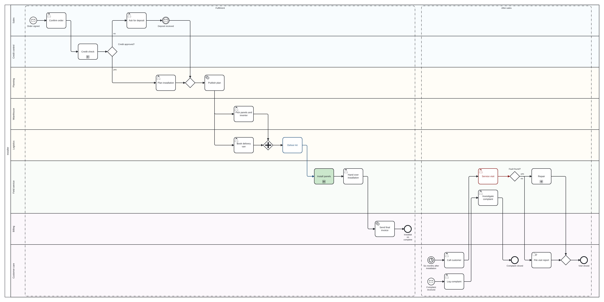
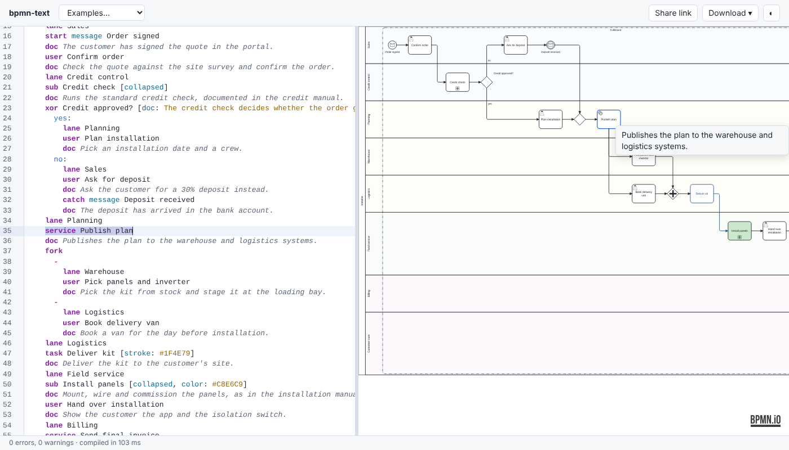

# bpmn-text

**Write BPMN diagrams as text and get laid-out BPMN 2.0 XML.**

bpmn-text compiles a compact, human-writable notation into standard BPMN 2.0
XML, **with automatic layout of pools, lanes and flows**. The result opens
in Camunda Modeler, bpmn.io, Signavio and other BPMN tools.

```bpmnt
pool Customer
  start Need product
  send Place order ~> Receive order
  receive Confirmation
  end Done

pool Company
  lane Sales
  receive Receive order
  task Check credit
  xor Credit OK?
    yes:
      lane Warehouse
      task Pick items
    no:
      task Request prepayment
      receive Payment received
  lane Warehouse
  task Ship parcel
  send Send confirmation ~> Confirmation
  end Shipped
```

You write the process in the order it happens. Sequence flows, join
gateways, lane placement and the whole diagram layout are inferred.

> **Status: in development.** The CLI and the compiler library produce
> laid-out BPMN for the whole notation: events, tasks, gateways, pools,
> lanes, message flows, subprocesses, boundary events, data, annotations,
> groups, colours and documentation. Work is tracked in
> [issues](../../issues) and [milestones](../../milestones).



## Quick start

One command installs everything into `~/bpmn-text` (Git and Node.js 22
needed), puts `bpmn-text` on your PATH, and with `--serve` / `-Serve`
starts the web editor at <http://localhost:8080>. Run the same command
again to update.

Linux and macOS:

```bash
curl -fsSL https://raw.githubusercontent.com/markbac/bpmn-text/main/scripts/update.sh | bash -s -- --serve
```

Windows (PowerShell):

```powershell
& ([scriptblock]::Create((irm https://raw.githubusercontent.com/markbac/bpmn-text/main/scripts/update.ps1))) -Serve
```

Leave out `--serve` / `-Serve` for just the command line. While the
repository is private, the raw URL needs a login, so fetch the script with
the GitHub CLI instead:

```bash
gh api repos/markbac/bpmn-text/contents/scripts/update.sh -H "Accept: application/vnd.github.raw" | bash -s -- --serve
```

```powershell
& ([scriptblock]::Create((gh api repos/markbac/bpmn-text/contents/scripts/update.ps1 -H "Accept: application/vnd.github.raw" | Out-String))) -Serve
```

or clone it yourself: `git clone https://github.com/markbac/bpmn-text
~/bpmn-text`, then `~/bpmn-text/scripts/update.sh --serve` (or
`~\bpmn-text\scripts\update.ps1 -Serve`). [Deployment](docs/deployment.md)
covers servers, Docker and proxies.

## Web editor



A live split-view editor runs entirely in the browser: type on the left and
see the diagram on the right, with inline errors, completion, selection
sync, downloads and share links. See [Deployment](docs/deployment.md) to
run it on your PC or a server, in Docker or not, and keep it up to date
with `scripts/update.sh` or `scripts/update.ps1`.

## Command line

Install it with the [Quick start](#quick-start) command, or from a
[release](../../releases): `npm install -g ./bpmn-text-<version>.tgz`.

```bash
bpmn-text build order.bpmnt -o order.bpmn          # or to stdout without -o
bpmn-text build "examples/*.bpmnt" -o out/         # several files into a directory
bpmn-text build order.bpmnt -f svg -o order.svg    # svg, or png with --scale 2
bpmn-text build order.bpmnt -o order.bpmn --watch  # rebuild on every change
bpmn-text check "**/*.bpmnt"                       # code frames; --format json
bpmn-text fmt order.bpmnt                          # rewrite in canonical style
bpmn-text fmt --check "**/*.bpmnt"                 # list unformatted files
cat order.bpmnt | bpmn-text build > order.bpmn     # stdin to stdout
```

Exit codes: 0 when everything is fine (warnings allowed), 1 when an input
has errors (or, with `fmt --check`, needs formatting), 2 for usage errors.
Colours are used on a terminal unless `NO_COLOR` is set.

SVG and PNG are drawn by bpmn-js in headless Chromium, exactly as the
editors draw them. They need the optional `playwright-core` package and a
browser: `npx playwright-core install chromium`, or set `BPMN_TEXT_CHROMIUM`
to a Chromium already installed, such as `/usr/bin/chromium`. `.bpmn`
output works without them.

## Library

```ts
import { compile } from 'bpmn-text';

const { xml, diagnostics, sourceMap } = await compile(source, {
  layout: { nodeSpacing: 60 }, // space between columns, default 50
  xorJoin: 'direct', // default for `option xor-join`
});
```

| Function | Returns |
|---|---|
| `compile(source, options?)` | `{ xml, model, layout, diagnostics, sourceMap }`. Never rejects on errors in the source; `xml` then shows what could be built. |
| `check(source, options?)` | `{ model, diagnostics }`, without layout. |
| `parse(source)` | `{ ast, diagnostics }` |
| `format(source)` | The source in canonical style. |

`sourceMap` maps every BPMN element ID to the source range it was written
at. The library has no Node-only dependencies, so it also runs in the
browser; pass `layout: { elk: new ELK({ workerUrl }) }` to run elkjs in a
Web Worker.

## Planned deliverables

| Deliverable | Description |
|---|---|
| **Compiler library** | `parse` / `check` / `compile` / `format`. Runs in Node and the browser. |
| **CLI** | `bpmn-text build \| check \| fmt`, outputs `.bpmn`, `.svg` and `.png`, with watch mode. |
| **Web editor** | Text on the left, live diagram on the right, fully client-side. |
| **VS Code extension** | Highlighting, diagnostics, completion, navigation and live preview. |

## Documentation

| Document | Contents |
|---|---|
| [Deployment](docs/deployment.md) | Running the editor and CLI on a PC or server, Docker images, the update scripts |
| [Tutorial](docs/tutorial.md) | Your first diagram in 15 minutes, step by step |
| [Cookbook](docs/cookbook.md) | Recipes for common patterns, and common errors with their fixes |
| [Functionality](docs/functionality.md) | Purpose, scope, functional and non-functional requirements |
| [Notation reference](docs/notation.md) | The `.bpmnt` language: elements, flows, gateways, lanes, diagnostics, grammar |
| [Architecture](docs/architecture.md) | C4 views, pipeline, packages, layout engine, BPMN generation, testing |
| [Decisions](docs/decisions.md) | Architecture decision records (ADRs) |
| [Development plan](docs/development-plan.md) | Milestones, critical path, issue breakdown |
| [Examples](examples/) | Example `.bpmnt` files covering every feature |

## Key design choices

* **Story order with lane switches.** `lane X` changes the lane for the
  steps that follow, and the flow continues across lanes automatically.
* **Automatic joins.** Open gateway branches merge into the next step
  through an inserted join gateway of the matching type.
* **Deterministic output.** Stable, readable IDs, so generated `.bpmn` files
  diff cleanly.
* **Lane-aware layout.** ELK layered layout for flow ordering, combined with
  custom lane banding and orthogonal routing. This is validated by a spike
  first (ADR-004).
* **Groups, colours, documentation, gateway-less fan-out**, so real-world
  diagrams can be transcribed faithfully (ADR-009–011).
* **Descriptive BPMN first.** Execution attributes (Camunda/Zeebe) are out of
  scope for v1, and an extension hook leaves room for them later.

## Tech stack

TypeScript monorepo (npm workspaces) · elkjs · bpmn-moddle · bpmn-js ·
CodeMirror 6 · vscode-languageserver · Vitest · Playwright

## Development

For contributors. To use bpmn-text, see the [Quick start](#quick-start).
Requires Node 20.19+ or 22.12+.

```bash
npm install
npx playwright-core install chromium   # once; used by the bpmn-js import check
npm run build      # tsup build of every workspace (ESM + .d.ts)
npm test           # Vitest across all workspaces
npm run test:coverage
npm run typecheck  # tsc -b over the project references
npm run lint       # ESLint (including dependency direction) and Prettier
```

Workspaces import each other through the `source` export condition, so
type checking and tests run against TypeScript sources without a prior
build. The allowed dependencies between workspaces (architecture §2) are
defined in `eslint.config.js` and enforced by `npm run lint`.

Every example in `examples/` has a golden `.bpmn` file next to its
source. After an intended change to the output, accept the new files with
`npx vitest run test/golden.test.ts -u`. Layout quality metrics of every
example are stored in `test/fixtures/layout/`; tests fail if a layout gets
worse, and `npm run test:update-baselines` stores new baselines on purpose.

`@bpmn-text/test-utils` (private) provides `expectSchemaValid`,
`expectModdleImport` and `expectBpmnJsImport` for asserting that generated
BPMN XML is valid against the OMG BPMN 2.0 XSDs (vendored in
`packages/test-utils/xsd`) and imports cleanly into bpmn-moddle and into
bpmn-js running in headless Chromium.

Every ```` ```bpmnt ```` block in the README and `docs/` is compiled by
`test/docs-snippets.test.ts` and must have no errors. Put
`<!-- expect-error BTxxx -->` before a block that shows a mistake, or
`<!-- fragment -->` before an excerpt that only has to parse. Every
```` ```mermaid ```` diagram there must parse too (`test/docs-diagrams.test.ts`).
`npm run screenshots` (after `npm run build`) renders the examples and the
blocks marked `<!-- screenshot: name -->` to `docs/images/`.

`npm run bench` (after `npm run build`, on Node 22) times parsing,
checking, layout and generation on synthetic diagrams of 50 to 500 nodes,
and warns when a phase is more than 20% slower than
`test/bench/baseline.json`; CI runs it on every build.
`npm run bench -- --update` stores a new baseline.
`test/performance.test.ts` checks that a 200-node collaboration compiles
in under a second.

### Continuous integration

`.github/workflows/ci.yml` runs lint, typecheck, tests with coverage and
build on every push to `main` and every pull request, on Node 20 and 22
under Ubuntu and Windows. The coverage summary appears on the run's summary
page.

Recommended branch protection for `main` (Settings → Branches):

- Require a pull request before merging
- Require status checks to pass, selecting all four `CI` matrix jobs
- Require branches to be up to date before merging

CI also uploads the web editor's static bundle as the `editor` artifact.

### Releases

Versions and changelogs are managed with
[Changesets](https://github.com/changesets/changesets); all packages share
one version.

1. With each change worth releasing, run `npm run changeset` and commit the
   file it writes.
1. To release, run `npm run release:version`, which bumps the versions and
   writes the changelogs, and commit the result.
1. Tag the commit `v<version>` and push the tag. The release workflow
   (`.github/workflows/release.yml`) tests, builds and creates a GitHub
   release with the artifacts.

`npm run release:pack` (after `npm run build`) makes the artifacts locally
in `release/`, and running the release workflow by hand is a dry run that
uploads them to the run instead of a release:

- `bpmn-text-<version>.tgz`: the CLI and library as one npm package, with
  the workspace packages bundled in;
- `bpmn-text-editor-<version>.zip`: the static web editor;
- the VS Code extension's `.vsix`, once it can be packaged (milestone M6).

npm publishing is not set up while the repository is private.

> **Note:** npm 10 crashes (`Cannot read properties of null (reading
> 'edgesOut')`) when it has to resolve Vitest 4 without a lockfile.
> Installing from the committed `package-lock.json` works with npm 10, but
> regenerate the lockfile or add dependencies with npm 11
> (`npx npm@11 install ...`).
