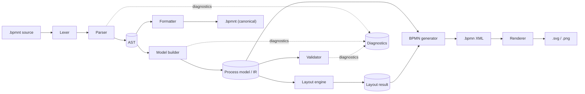
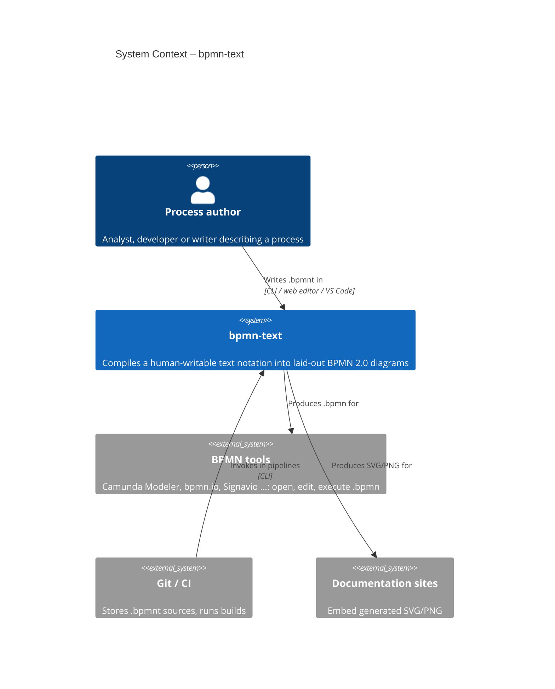
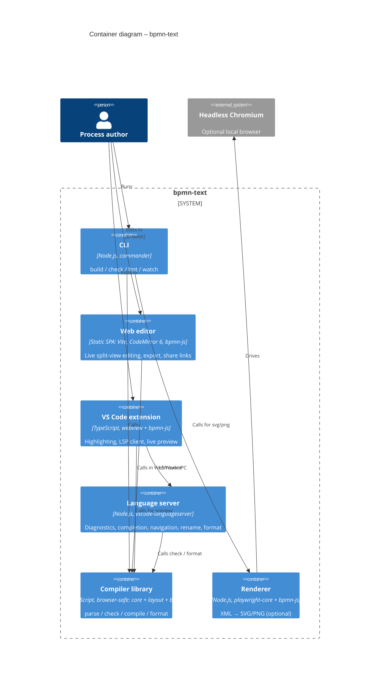
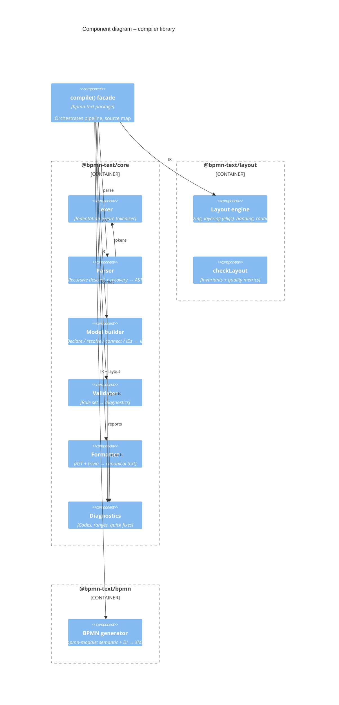

# Architecture

## 1. Overview

bpmn-text is a compiler. Text goes in and BPMN 2.0 XML with diagram
interchange (DI) comes out. Every front end (CLI, web editor, VS Code) is a
thin shell around the same pipeline.



The pipeline stages are pure functions over plain data, so each one can be
tested on its own, run in a Web Worker and cached.

## 1a. C4 model

The C4 diagrams below are written in Mermaid C4 syntax, which GitHub
renders inline.

### Level 1: System context



### Level 2: Containers



### Level 3: Components of the compiler library



Level 4 (code) is covered by the type sketches in §3–§7.

## 2. Repository layout (npm workspaces monorepo)

```
bpmn-text/
├─ packages/
│  ├─ core/              @bpmn-text/core      lexer, parser, AST, model builder, validator, formatter, diagnostics
│  ├─ layout/            @bpmn-text/layout    layout engine (elkjs + lane banding + routing)
│  ├─ bpmn/              @bpmn-text/bpmn      IR + layout → BPMN XML (bpmn-moddle)
│  ├─ render/            @bpmn-text/render    XML → SVG/PNG (bpmn-js in headless Chromium)
│  ├─ cli/               bpmn-text            CLI + the public compile() facade
│  ├─ language-server/   @bpmn-text/language-server  LSP implementation
│  └─ test-utils/        @bpmn-text/test-utils  BPMN validity assertions for tests (private)
├─ apps/
│  ├─ editor/            live web editor (Vite, CodeMirror 6, bpmn-js)
│  └─ vscode/            VS Code extension (TextMate grammar, LSP client, preview webview)
├─ examples/             golden example corpus (.bpmnt)
├─ test/fixtures/        expected outputs and layout-quality baselines
└─ docs/
```

Dependency direction (no cycles):

```
core ← layout ← bpmn ← cli
core ← language-server ← apps/vscode
core, layout, bpmn ← apps/editor
bpmn ← render ← cli (optional)
test-utils ← tests of any workspace
```

`core`, `layout` and `bpmn` must not use Node-only APIs (NFR-2).

## 3. Core: lexer and parser

### 3.1 Lexer

* Line-oriented and indentation-aware. It emits `INDENT`/`DEDENT` tokens
  from an indentation stack, as Python's tokenizer does. It ignores blank and
  comment-only lines.
* Bare names are context-sensitive (they run to a terminator; see notation
  §2). The lexer therefore produces a **line token stream**: keyword
  candidates, operators (`->`, `-(`, `)->`, `~>`, `~(`, `)~>`, `:`, `-`,
  `@`, `[`, `]`, `,`), strings and *text runs*. The parser decides whether a
  text run is a name or a keyword.
* Every token carries `{ line, col, offset, length }`.
* Comments are kept as trivia attached to tokens, so the formatter can
  preserve them.

### 3.2 Parser

* A hand-written recursive-descent parser. A parser generator was not used
  because indentation, context-sensitive bare names and high-quality error
  recovery are all easier to control by hand.
* **Error recovery** works per line. On an error the parser records a
  diagnostic, skips to the end of the line, and continues at the same
  indentation level. One run reports every error (FR-6).
* Output is an **AST** that mirrors the text closely: statements, chains,
  branches and blocks. Every node has a source range.

```ts
type Statement =
  | ElementStmt   // { element: ElementDecl; tail: FlowStep[]; boundaries: BoundaryStmt[] }
  | GatewayStmt   // { gateway: ElementDecl; branches: Branch[] }
  | SubStmt       // { decl: ElementDecl; body: Statement[]; boundaries: BoundaryStmt[] }
  | LaneStmt | LanesStmt | GotoStmt | MessageStmt | NoteStmt | DataStmt;

interface ElementDecl { kind: ElementKind; eventType?: EventType; name?: string;
                        id?: string; attrs: Attr[]; range: Range }
interface FlowStep    { op: '->' | '~>'; label?: string; target: ElementDecl | Ref }
interface Branch      { kind: 'labelled' | 'bullet' | 'else'; label?: string;
                        inline?: FlowStep[] | ElementDecl; body: Statement[] }
```

### 3.3 Formatter

The formatter works from the AST plus comment trivia. It prints canonical
style: 2-space indentation, one space around arrows, quotes only where
required, and comments preserved. It must satisfy `parse(format(x)) ≡
parse(x)`, which is checked by a property test over the examples.

## 4. Core: model builder (AST → IR)

The IR is a format-independent process model, close to the BPMN metamodel
but simpler:

```ts
interface Model {
  title?: string;
  documentation?: string;
  pools: Pool[];                 // always ≥ 1 (implicit pool for plain processes)
  messageFlows: MessageFlow[];
  dataStores: DataStore[];
  groups: Group[];               // document order = column order
}
interface Style   { fill?: string; stroke?: string }      // normalised #RRGGBB
interface Group   { id; name; fit: boolean; style?: Style; documentation?: string;
                    members: string[] /* flow node ids, across pools */ }
interface Pool    { id; name; collapsed: boolean; implicit: boolean; style?: Style;
                    documentation?: string; lanes: Lane[]; process?: Container }
interface Container {            // a process or a subprocess
  nodes: FlowNode[];            // events, tasks, gateways, subprocesses
  flows: SequenceFlow[];
  dataObjects: DataObject[];
  annotations: Annotation[];
}
interface FlowNode { id; kind; eventType?; name?; laneId?; groupId?; markers;
                     boundaries: BoundaryEvent[]; children?: Container;
                     style?: Style; documentation?: string;
                     generated?: 'join';        // inserted join gateway
                     source: Range }            // source map for editor/LSP
```

The builder runs in passes:

1. **Declare.** Walk the AST, create IR nodes, assign lanes (a lane-scope
   stack is pushed for each branch and boundary chain), and register names
   and IDs in a symbol table. Group blocks are *transparent*: they set the
   current group on the nodes declared inside them, and push no flow or
   lane scope. `doc` and `[doc:]` attach documentation, and colour
   attributes are normalised into a `Style`.
2. **Resolve.** Bind references to targets using `@id`, then normalised name.
   Report BT201/BT202 with closest-match suggestions (Damerau–Levenshtein).
3. **Connect.** Apply the implicit-flow rules from notation §5–§7. The
   builder tracks a set of **open ends** (node + pending label + default
   flag). At the end of each gateway block, it merges them into the next
   statement, inserting join gateways where the rules require. A `start`
   discards the current open ends (reporting each as BT302). A `fork`
   gives each branch an open end that starts at the preceding element, with
   no gateway node. Multi-target jumps create one flow per target.
4. **IDs.** Assign deterministic IDs (§8).

Each pass reports diagnostics and still returns a best-effort model, so the
editor can draw a diagram while errors are present.

## 5. Validator

The validator is a set of independent **rules** over the IR. Each rule is a
function `(model) => Diagnostic[]` with its own code and default severity
(notation §11). Rules can be turned on or off through options, and in a
later version through `option` directives.

## 6. Layout engine

Layout is the hardest part of the project and gets its own package. Stock
`bpmn-auto-layout` does not handle lanes and pools. General-purpose ELK
layouts have no concept of *bands*: lanes are full-width horizontal strips
that the flow crosses. The engine therefore uses ELK for what it does well
(layering and ordering) and handles banding and routing with custom code.

> The spike in issue #3 confirmed this approach (ADR-004 in
> [decisions.md](decisions.md)); its report and prototype are in
> [spikes/lane-layout](spikes/lane-layout/README.md). The phases below
> include what it changed.

### 6.1 Interface

```ts
interface LayoutEngine {
  layout(model: Model, options?: LayoutOptions): Promise<LayoutResult>;
}
interface LayoutResult {
  shapes: Map<string, Bounds & { label?: Bounds }>;   // pools, lanes, nodes, data, annotations
  edges:  Map<string, { waypoints: Point[]; label?: Bounds }>;
}
```

The interface is asynchronous because elkjs runs in a worker in the browser.

### 6.2 Phases

| # | Phase | Description |
|---|---|---|
| 0 | **Sizing** | Standard BPMN sizes: task 100×80, event 36×36, gateway 50×50, data object 36×50, data store 50×50. Label sizes are estimated from text length (with a font-metrics table, so the result is the same in Node and the browser). |
| 1 | **Subprocesses** | Expanded subprocesses are laid out bottom-up, recursively running the whole engine on their body. The result fixes their size. Collapsed ones get task size and a separate diagram plane. |
| 2 | **Global layering** | All flow nodes of **all pools** go into one ELK `layered` graph (direction RIGHT). Edges are sequence flows (high priority) and message flows (low priority, used only to align columns across pools, FR-25). `considerModelOrder` keeps the model order, and model-order cycle breaking makes loops show as back edges. The model order is a **story order across pools**: each pool's document order, merged so that a message flow's target comes after its source (document order breaks ties and cycles). Listing pools one after another instead makes message flows to an earlier pool look like loops, and ELK reverses them. Boundary events are folded into their host. **Groups** use ELK *partitioning* (`elk.partitioning.activate`): each node gets a partition index from its group's document order, with ungrouped nodes between groups getting their own partitions. All columns of group *i* therefore come before those of group *i+1* and are never shared (FR-29). Output: a **layer** (column) and in-layer order for each node. ELK reports coordinates rather than layer indices, so columns are recovered by grouping nodes whose x ranges overlap. |
| 3 | **Band assignment** | For each pool and each lane, the nodes in each layer are stacked into **rows**, ordered by the ELK order with a barycentre pass to reduce crossings. The *main path* (first branch of each split) is kept on row 0 so the happy path is a straight line. Lane height = rows × row height + padding, plus extra rows reserved for boundary chains and data objects. |
| 4 | **Coordinates** | Column x positions are shared across all pools. Each gap between columns is widened to fit the number of edge tracks routed through it. Lane y positions are stacked within the pool, and pools are stacked with a fixed gap. Every lane is stretched to the pool width, and every pool to the widest pool (FR-21/22). |
| 5 | **Sequence-flow routing** | Orthogonal routing through the **channels** between columns and the **gutters** between rows. Each edge segment in a channel gets its own track, so parallel segments do not overlap. BPMN conventions apply: gateways exit from their top or bottom side towards branches above or below, and back edges leave from the bottom and run along the lane gutter. Long edges that skip columns use virtual points through free row space. Each edge's shape is chosen by checking for obstacles: a gateway corner exit or join entry is used only when its vertical leg is clear, otherwise the edge turns in a channel, and a same-row edge with shapes in between detours through the gap between rows. Channel widths come from a first routing pass that only counts tracks; the second pass routes on the widened geometry. |
| 6 | **Message flows** | Routed vertically between pools. If the endpoint x positions differ, an elbow is placed in the gap between the pools. Collapsed pools are thin bands, and their flows attach at the other endpoint's x position. A flow whose vertical would cut through shapes in other lanes leaves its shape with a short stub and turns into the column channel first. |
| 7 | **Attachments** | Boundary events are spread evenly along the host's bottom border, and their chains run downwards into the reserved rows. Data objects and stores are placed in a reserved row next to their activity, and annotations above their element, each with an association line. |
| 8 | **Labels** | External labels for events (below), gateways (above), and flows (next to the first segment, avoiding shapes). |
| 9 | **Groups** | Each group box covers its column range (with padding into the column gaps). Vertically it spans the full height of every pool the group occurs in, or with `[fit]` the bounding box of its members. Group labels go at the top centre. Gaps between columns at group boundaries are widened so the dashed borders never touch shapes or labels. |

### 6.3 Layout quality checks

`@bpmn-text/layout` exports a `checkLayout(model, result)` function used in
tests and benchmarks. It reports:

* overlapping shapes (must be 0);
* nodes outside their lane band (must be 0);
* edge segments crossing a shape (must be 0);
* edge crossings, bends and total edge length, compared against stored
  baselines so regressions fail CI.

## 7. BPMN generator

* Uses **bpmn-moddle** to build `bpmn:Definitions`, so the output is
  schema-correct by construction.
* **Semantic part:** a `collaboration` with `participant`s and
  `messageFlow`s when there are pools. Each expanded pool has a `process`
  with a `laneSet`, `flowNodeRef`s, `sequenceFlow`s with `default` on
  gateways, `dataObject`/`dataObjectReference`/`dataStoreReference`,
  `textAnnotation` with `association`, `boundaryEvent` with `attachedToRef`
  and `cancelActivity`, and event definitions.
* **Groups:** a `bpmn:category` with one `categoryValue` per group, and
  `bpmn:group` elements (`categoryValueRef`) in the collaboration, or in the
  process when there is no collaboration.
* **Documentation:** `bpmn:documentation` children (`textFormat="text/plain"`).
* **Colours:** the OMG `color:` namespace
  (`http://www.omg.org/spec/BPMN/non-normative/color/1.0`) and the bpmn-js
  `bioc:` namespace (`http://bpmn.io/schema/bpmn/biocolor/1.0`) on
  `BPMNShape`/`BPMNEdge`. Edges inherit the stroke of their source element
  only when the source sets one.
* **DI part:** one `BPMNDiagram` per plane (main plane plus one per
  collapsed subprocess). It contains `BPMNShape` (with `isHorizontal="true"`
  for pools and lanes, and `isExpanded` for subprocesses), `BPMNEdge` with
  waypoints, and `BPMNLabel` bounds.
* The XML is serialised with stable attribute order and formatting.

## 8. Deterministic IDs

* An ID is built from a type prefix and a slug of the name:
  `Activity_check_credit`, `Gateway_credit_ok`, `Event_done`,
  `Participant_company`, `Lane_sales`.
* Unnamed elements get a slug of their parent and position: `Event_start_1`,
  `Gateway_join_after_issue_invoice`.
* Flows: `Flow_<source>__<target>`, with a numeric suffix if repeated.
* Collisions get a numeric suffix in document order.
* `@id` from the source is used unchanged.

## 9. Extensibility

* **Unknown attributes** are kept on the IR node (`extra: Record<string,
  string>`). A generator **extension hook** (`(irNode, moddleElement) =>
  void`) can turn them into vendor extension elements. This is how
  executable Camunda/Zeebe support could be added later without changing the
  grammar.
* **Layout options** (spacing, row height, xor-join style) are passed
  through `compile()` options and the `option` directive.

## 10. Public API

```ts
import { compile, parse, check, format } from 'bpmn-text';

const { xml, diagnostics, model, layout } = await compile(source, {
  filename: 'order.bpmnt',
  layout: { nodeSpacing: 50 },
});
```

* `parse(source)` → `{ ast, diagnostics }`
* `check(source)` → `{ model, diagnostics }` (no layout; fast, used by the
  LSP)
* `compile(source, opts)` → `{ xml, model, layout, diagnostics }`
* `format(source)` → `string`
* `sourceMap` on the result maps BPMN element IDs to source ranges, for
  click-to-source in the editors.

## 11. Front ends

### 11.1 CLI (`packages/cli`)

Built on `commander`. Commands: `build`, `check`, `fmt`. Watch mode uses
`chokidar`. Code frames are printed with `@babel/code-frame`-style
formatting. Exit codes: 0 ok, 1 errors in input, 2 usage or internal error.

### 11.2 Renderer (`packages/render`)

Loads the generated XML into the **bpmn-js** viewer inside headless Chromium
(`playwright-core`, an *optional* dependency), then exports SVG (`saveSVG`)
or a PNG screenshot. This gives exactly the same rendering as the editors.
If Chromium is unavailable, the CLI explains how to enable it. The reasoning
is in [decisions.md](decisions.md) ADR-005.

### 11.3 Web editor (`apps/editor`)

* Vite + TypeScript, **CodeMirror 6** (lighter than Monaco). It uses a
  `StreamLanguage` highlighter and lint integration fed by core diagnostics.
* Compilation runs in a **Web Worker** with a 150 ms debounce. While there
  are errors the last good diagram stays visible.
* The diagram is drawn with the bpmn-js `NavigatedViewer`. The viewport
  (zoom and scroll) is kept between updates.
* Two-way selection sync through the `sourceMap`.
* Static build, deployable anywhere (GitHub Pages, Netlify, an intranet).

### 11.4 Language server and VS Code (`packages/language-server`, `apps/vscode`)

* The LSP is built on `vscode-languageserver`. It re-runs `check()` on every
  change, since whole-document parsing is fast enough for these file sizes.
  It provides diagnostics, completion, hover, definition, references,
  rename, document symbols and formatting.
* The VS Code extension contains a TextMate grammar, the LSP client and a
  webview preview that bundles bpmn-js and runs `compile()` on the document,
  synced through the `sourceMap`. The extension is packaged as a `.vsix`.

## 12. Testing strategy

| Level | What | Tooling |
|---|---|---|
| Unit | Lexer tokens, parser AST snapshots, builder passes, each validator rule | Vitest |
| Golden | Every file in `examples/` and `test/fixtures/*.bpmnt` → normalised XML snapshot | Vitest snapshots |
| Schema | Generated XML validated against the BPMN 2.0 XSD | `xmllint-wasm` |
| Import | Generated XML imported by bpmn-moddle (no warnings) and by bpmn-js in headless Chromium (no warnings) | Vitest + Playwright |
| Layout quality | `checkLayout` invariants plus baseline metrics | Vitest |
| Property | `parse(format(x)) ≡ parse(x)`. The parser never throws on random input. | fast-check |
| E2E | CLI commands on fixtures. Editor smoke test (type → diagram updates). | Vitest, Playwright |

## 13. Tooling

npm workspaces · TypeScript (strict) · tsup (builds) · Vitest · ESLint +
Prettier · Changesets (versioning) · GitHub Actions CI (Node 20 and 22,
lint/typecheck/test/build) · Renovate or Dependabot.
