# Cookbook

Short recipes for common process patterns, and for the errors you are most
likely to meet. Every example here is compiled in CI, so it works as
written. The [notation reference](notation.md) has the full rules.

## Loops

### Rework until done

Jump back with `-> Name`. A line that ends with a jump does not continue to
the next line.

<!-- screenshot: cookbook-rework -->

```bpmnt
start
user Write draft
user Review draft
xor Approved?
  yes: end Published
  no:
    user Revise draft
    -> Review draft
```

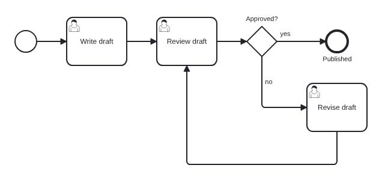

### A repeated activity

When the repetition is a detail of one activity, a marker is clearer than
a loop: `[loop]`, or `[parallel]` / `[sequential]` for multi-instance.

<!-- screenshot: cookbook-markers -->

```bpmnt
start
service Send reminder [loop]
user Approve each line item [parallel]
end
```

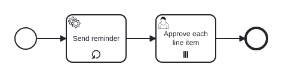

## Skipping ahead

A branch can jump forward past steps the other branch needs.

<!-- screenshot: cookbook-skip -->

```bpmnt
start
task Check order
xor Gift wrapping?
  yes: task Wrap gift
  no:
    -> Ship parcel
task Print card
task Ship parcel
end
```

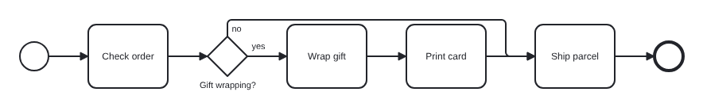

## Merges that are not well structured

Automatic joins handle branches that end open at the end of the gateway
block. For anything else, declare a gateway with an `@id` and jump to it
from wherever you need.

<!-- screenshot: cookbook-merge -->

```bpmnt
start
xor Customer type?
  new:
    task Create account
    -> @merge
  existing:
    task Check details
    xor Details changed?
      yes:
        task Update account
        -> @merge
      no:
        -> @merge
xor Merge @merge
task Take payment
end
```

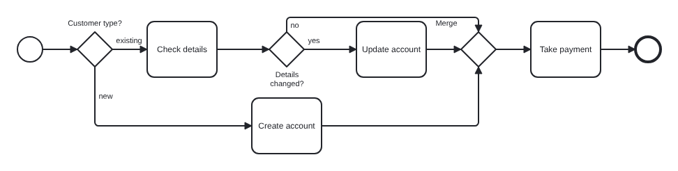

## Parallel work

`and` runs all branches; the open ones are joined by an inserted parallel
gateway before the next step.

<!-- screenshot: cookbook-parallel -->

```bpmnt
start Order paid
and
  - task Pick items
  - task Print invoice
  - task Book courier
task Ship parcel
end
```

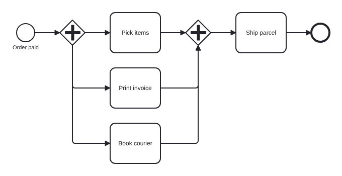

### Without a gateway

`fork` splits like `and` but draws no split gateway: each branch starts
with a flow straight from the previous step. Use it to transcribe diagrams
that have several outgoing flows from one task.

<!-- screenshot: cookbook-fork -->

```bpmnt
start
service Publish order
fork
  - service Update billing
  - service Update CRM
end Synced
```

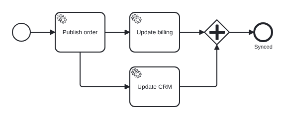

## Escalations and timeouts

Boundary events go in an indented block under their activity. An
interrupting one stops the activity; its chain merges back after it if it
ends open. A non-interrupting one runs alongside, and must end with an
`end` or a jump.

<!-- screenshot: cookbook-escalation -->

```bpmnt
start
user Approve request
  on timer 2 days [non-interrupting] -> send Remind approver -> end Reminded
  on timer 5 days -> user Escalate to manager
task Notify requester
end
```

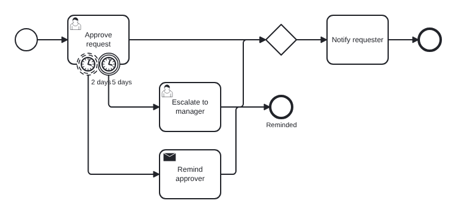

### Waiting for the first of several events

An event-based gateway waits for whichever event comes first.

<!-- screenshot: cookbook-event-gateway -->

```bpmnt
start
send Send quote
event Wait for answer
  - receive Quote accepted -> task Create order
  - receive Quote rejected -> end Lost
  - wait 30 days -> end Expired
end Ordered
```

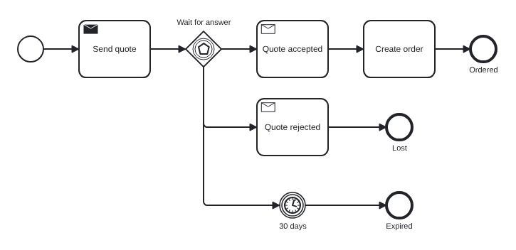

## Several parties

### Request and response

Each party is a pool; `~>` connects their steps. Write the pools in the
order the conversation starts.

<!-- screenshot: cookbook-request-response -->

```bpmnt
pool Customer
  start
  send Ask for quote ~> Quote requested
  receive Quote
  end

pool Supplier
  start message Quote requested
  task Price the request
  send Send quote ~> Quote
  end
```

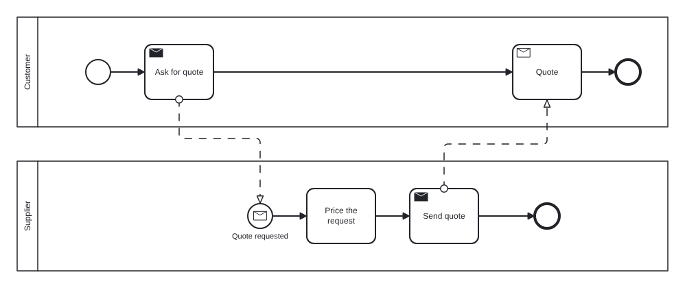

### A partner you do not model

A collapsed pool is a black box. Message flows can attach to the pool
itself.

<!-- screenshot: cookbook-black-box -->

```bpmnt
pool Shop
  start
  send Request payment ~(card details)~> Payment provider
  receive Payment confirmed
  end

pool Payment provider [collapsed]
Payment provider ~> Payment confirmed
```

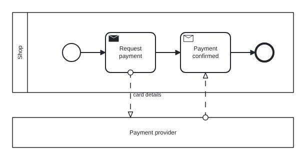

## Phases

Groups mark phases of a process. They do not change the flow; layout gives
each group its own columns and draws a dashed box around them.

<!-- screenshot: cookbook-phases -->

```bpmnt
pool Company
  lanes Sales, Service
  group Sale
    lane Sales
    start
    user Sign contract
  group Service [color: #FFF5F5]
    lane Service
    user Install
    end
```

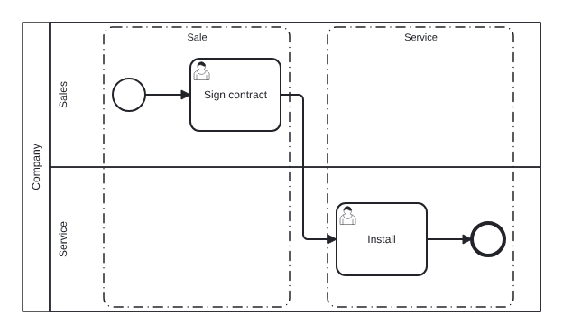

## Data and notes

`[reads: …]` and `[writes: …]` draw data associations; data objects are
created on first use, and `store` declares a data store. `note` attaches a
text annotation and `doc` adds documentation to the step before it.

<!-- screenshot: cookbook-data -->

```bpmnt
store Customer database
start
task Check customer [reads: Customer database, writes: Credit report]
note Uses the nightly snapshot
task Decide [reads: Credit report]
doc Approve when the score is above 600.
end
```

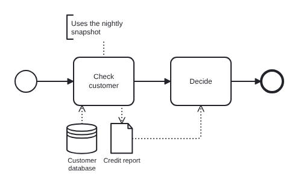

## Common errors and how to fix them

### BT201: ambiguous reference

Two elements have the same name, and a jump to that name does not know
which one you mean.

<!-- expect-error BT201 -->

```bpmnt
start
task Check order
task Fix order
task Check order
-> Check order
```

Fix: give the one you mean an `@id` and jump to that.

```bpmnt
start
task Check order @first_check
task Fix order
task Check order
-> @first_check
```

### BT202: unknown reference

A typo in a name. The message suggests the closest name, and the editor
offers it as a quick fix.

<!-- expect-error BT202 -->

```bpmnt
start
task Check order
task Fix order
-> Check ordre
```

### BT230: element before the first lane

In a pool with lanes, every element needs a lane. Add a `lane` line
before the first element.

<!-- expect-error BT230 -->

```bpmnt
pool Company
  start
  lane Sales
  task Sell
  end
```

### BT302: dead end

A step that is not an end event and has no outgoing flow, for example
before a second `start`. End the first chain explicitly.

<!-- expect-error BT302 -->

```bpmnt
start Morning
task Open shop
start Evening
task Close shop
end
```

### BT210: sequence flow across pools

Pools talk with messages (`~>`), not sequence flows (`->`).

<!-- expect-error BT210 -->

```bpmnt
pool Customer
  start
  task Order -> Receive order

pool Shop
  task Receive order
  end
```

### BT224: fork with nothing to fan out from

`fork` needs an open step before it, not an end event or a jump.

<!-- expect-error BT224 -->

```bpmnt
start
end
fork
  - task A
  - task B
```
