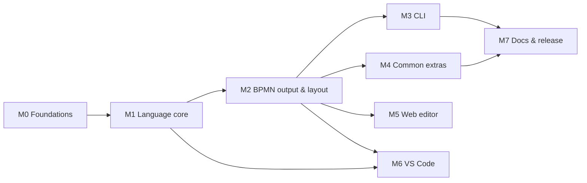

# Development plan

The work is split into eight milestones. Every item below is a GitHub issue
with tasks, acceptance criteria and dependencies. Issue numbers match the
repository's issues.

## Milestones

| Milestone | Goal | Issues |
|---|---|---|
| **M0 – Foundations** | Repo, CI, test harness, layout spike, example corpus. | #1–#5 |
| **M1 – Language core** | Lexer, parser, diagnostics, model builder, implicit flow, validation, formatter. | #6–#16 |
| **M2 – BPMN output & layout** | BPMN XML + DI generation and the lane/pool-aware layout engine; compile() API. | #17–#26 |
| **M3 – CLI** | bpmn-text build / check / fmt and SVG/PNG rendering. | #27–#30 |
| **M4 – Common extras** | Intermediate & boundary events, subprocesses, data, annotations, markers, groups, colours, fan-out and documentation end-to-end. | #31–#36, #51–#57 |
| **M5 – Web editor** | Live split-view editor running fully client-side. | #37–#42 |
| **M6 – VS Code extension** | Language server, extension, live preview, packaging. | #43–#46 |
| **M7 – Docs & release** | Tutorial, cookbook, benchmarks, release workflow. | #47–#50 |

## Critical path

* The **layout spike (#3)** is the main technical risk, so it runs first. Its
  outcome may change the layout issues in M2.
* After M2, the **CLI (M3)**, **extras (M4)** and **web editor (M5)** can be
  worked on in parallel. The language server (#43) needs only M1.
* **First usable release:** the end of M3, a CLI covering the core notation.
  **Feature complete:** the end of M6.

## Issues

### M0 – Foundations

| # | Issue | Labels | Depends on |
|---|---|---|---|
| #1 | Set up monorepo and tooling | `type: chore` `area: infra` | — |
| #2 | CI pipeline on GitHub Actions | `type: chore` `area: infra` | #1 |
| #3 | Spike: lane-aware layout approach (ADR-004) | `type: spike` `area: layout` | #1 |
| #4 | Test harness: BPMN validity checks (XSD, bpmn-moddle, bpmn-js import) | `type: test` `area: infra` | #1 |
| #5 | Golden example corpus and fixture conventions | `type: test` `type: docs` | #1 |

### M1 – Language core

| # | Issue | Labels | Depends on |
|---|---|---|---|
| #6 | Lexer: indentation, strings, operators and bare-name text runs | `type: feature` `area: parser` | #1 |
| #7 | Diagnostics framework | `type: feature` `area: parser` | #1 |
| #8 | Parser: element statements, chains, jumps, directives, pools and lanes | `type: feature` `area: parser` | #6, #7 |
| #9 | Parser: gateway blocks and branches | `type: feature` `area: parser` | #8 |
| #10 | Parser: subprocesses, boundary events, notes, data and attributes | `type: feature` `area: parser` | #8 |
| #11 | Model IR and declare pass (symbol table, lane scoping) | `type: feature` `area: model` | #8 |
| #12 | Reference resolution with suggestions | `type: feature` `area: model` | #11 |
| #13 | Implicit flow and automatic join gateways | `type: feature` `area: model` | #9, #11, #12 |
| #14 | Validator rules | `type: feature` `area: model` | #13 |
| #15 | Deterministic ID generation | `type: feature` `area: model` | #11 |
| #16 | Formatter | `type: feature` `area: parser` | #8, #9, #10 |

### M2 – BPMN output & layout

| # | Issue | Labels | Depends on |
|---|---|---|---|
| #17 | BPMN semantic XML generation (bpmn-moddle) | `type: feature` `area: bpmn` | #13, #15 |
| #18 | Layout engine scaffold, sizing and label metrics | `type: feature` `area: layout` | #3, #11 |
| #19 | Layout: global layering and ordering | `type: feature` `area: layout` | #18 |
| #20 | Layout: lane and pool banding and coordinates | `type: feature` `area: layout` | #19 |
| #21 | Layout: orthogonal sequence-flow routing | `type: feature` `area: layout` | #20 |
| #22 | Layout: message flows and collapsed pools | `type: feature` `area: layout` | #21 |
| #23 | Layout quality checks and baselines (checkLayout) | `type: test` `area: layout` | #18 |
| #24 | BPMN DI generation | `type: feature` `area: bpmn` | #17, #20 |
| #25 | Public compile() API and source map | `type: feature` `area: api` | #17, #24 |
| #26 | End-to-end golden tests for core examples | `type: test` | #4, #5, #23, #25 |

### M3 – CLI

| # | Issue | Labels | Depends on |
|---|---|---|---|
| #27 | CLI: build and watch | `type: feature` `area: cli` | #25 |
| #28 | CLI: check with code frames and JSON output | `type: feature` `area: cli` | #25 |
| #29 | CLI: fmt | `type: feature` `area: cli` | #16 |
| #30 | Renderer: SVG and PNG via bpmn-js in headless Chromium | `type: feature` `area: render` | #25 |

### M4 – Common extras

| # | Issue | Labels | Depends on |
|---|---|---|---|
| #31 | Intermediate events, timers and event-based gateway end-to-end | `type: feature` `area: layout` `area: bpmn` | #26 |
| #32 | Boundary events end-to-end | `type: feature` `area: layout` `area: bpmn` | #26 |
| #33 | Embedded subprocesses: expanded and collapsed | `type: feature` `area: layout` `area: bpmn` | #26 |
| #34 | Data objects, data stores and associations | `type: feature` `area: model` `area: layout` `area: bpmn` | #26 |
| #35 | Text annotations | `type: feature` `area: layout` `area: bpmn` | #26 |
| #36 | Activity markers and call activities | `type: feature` `area: bpmn` | #26 |
| #51 | Groups: notation, model and BPMN output | `type: feature` `area: parser` `area: model` `area: bpmn` | #13, #17 |
| #52 | Layout: group column partitions and group boxes | `type: feature` `area: layout` | #51, #20, #23 |
| #53 | Colours on pools, lanes, groups and elements | `type: feature` `area: parser` `area: bpmn` | #24 |
| #54 | Fan-out without gateways: multi-target jumps and fork | `type: feature` `area: parser` `area: model` | #13 |
| #55 | Element documentation (doc and [doc:]) | `type: feature` `area: parser` `area: model` `area: bpmn` | #10, #17 |
| #56 | Collapsed subprocess placeholders (sub without body) | `type: feature` `area: parser` `area: bpmn` | #33 |
| #57 | Realistic multi-phase example as acceptance test | `type: test` | #51, #52, #53, #54, #55, #56 |

### M5 – Web editor

| # | Issue | Labels | Depends on |
|---|---|---|---|
| #37 | Web editor scaffold: split view with CodeMirror and bpmn-js | `type: feature` `area: editor` | #25 |
| #38 | Editor: live compile in a Web Worker with inline diagnostics | `type: feature` `area: editor` | #37 |
| #39 | Editor: syntax highlighting and completion | `type: feature` `area: editor` | #37 |
| #40 | Editor: two-way selection sync via source map | `type: feature` `area: editor` | #38 |
| #41 | Editor: export, examples, local save and share links | `type: feature` `area: editor` | #38 |
| #42 | Editor: static deployment | `type: chore` `area: editor` `area: infra` | #41 |

### M6 – VS Code extension

| # | Issue | Labels | Depends on |
|---|---|---|---|
| #43 | Language server | `type: feature` `area: lsp` | #14, #16 |
| #44 | VS Code extension: grammar, language configuration, LSP client | `type: feature` `area: vscode` | #43 |
| #45 | VS Code live preview webview | `type: feature` `area: vscode` | #44, #25 |
| #46 | Package and release the VS Code extension | `type: chore` `area: vscode` `area: infra` | #45 |

### M7 – Docs & release

| # | Issue | Labels | Depends on |
|---|---|---|---|
| #47 | Tutorial and cookbook documentation | `type: docs` | #26 |
| #48 | Compile documentation snippets in CI | `type: test` `type: docs` `area: infra` | #27 |
| #49 | Versioning and release workflow | `type: chore` `area: infra` | #2 |
| #50 | Performance benchmarks | `type: test` | #26 |

## Working agreements

* One issue per pull request where possible. PRs reference their issue
  (`Closes #n`).
* Every feature PR adds or updates a golden example or fixture.
* Notation changes update `docs/notation.md` **in the same PR**. Design
  changes add or amend an ADR in `docs/decisions.md`.
