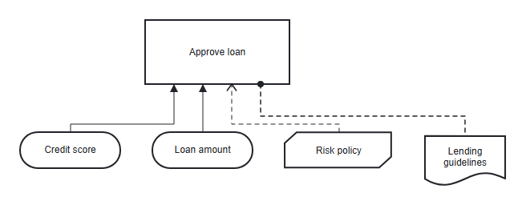

# bpmn-text DMN notation reference

Version: **0.1 (draft)**. File extension: **`.dmnt`**

The DMN notation writes **decision requirements diagrams** (DRDs) and the
**decision tables** and **literal expressions** behind them as text. A `.dmnt`
file compiles to DMN 1.3 XML with diagram interchange (DMNDI), which opens laid
out in Camunda Modeler and in bpmn.io's `dmn-js`. It shares the lexical rules,
comments, attributes, `doc` text and colours of the BPMN notation
([notation.md](notation.md)); this page covers what is different.

<!-- screenshot: dmn-intro -->

```dmnt
title Loan approval

input Credit score [type: number]
input Loan amount [type: number]
knowledge Risk policy
source Lending guidelines

decision Approve loan [requires: Credit score, Loan amount, Risk policy, Lending guidelines]
  table [hit: unique]
    | Credit score | Loan amount | -> Approved: boolean | Reason: string    |
    | >= 700       | <= 50000    | true                 | "Good score"      |
    | >= 700       | > 50000     | false                | "Amount too high" |
    | < 700        | -           | false                | "Low score"       |
```



Why text: DMN XML is hard to read and to diff, so rule changes are hard to
review. Here one rule is one line, and the compiler reports what graphical tools
do not, such as rules that overlap or inputs that no rule covers, as diagnostics
with line and column numbers ([ADR-015](decisions.md)).

---

## 1. Document structure

```text
document   := directive* element*
directive  := 'title' NAME
element    := input | decision | knowledge | source
```

* **`title`** names the DMN `definitions` and is the default output filename.
  Without one, the definitions are named "Decisions".
* Elements can be written in any order; `[requires: …]` can name elements written
  further down. The DRD is laid out automatically, inputs at the bottom and the
  decisions that use them above (§6).
* `#` comments, blank lines, quoting, `@id`, `doc` and colours work as in the BPMN
  notation ([notation.md §2](notation.md), §4.5 to §4.7).
* `option` directives, flows, pools, lanes and notes are BPMN only.

---

## 2. Elements

Every element has the same shape:

```text
<keyword> <name> [@id] [[attributes]]
  <doc, table or literal>
```

| Keyword | DMN element | Drawn as | Can hold |
|---|---|---|---|
| `input` | Input data | Rounded box | `doc` |
| `decision` | Decision | Box | `doc`, one `table` or one `literal` |
| `knowledge` | Business knowledge model | Box with cut corners | `doc`, one `literal` |
| `source` | Knowledge source | Box with a wavy bottom | `doc` |

```dmnt
input Customer type [type: string, values: "business", "private"]
input Order total [type: number]
knowledge Discount rules
source Pricing policy [doc: "Agreed by the board in 2026"]

decision Discount [requires: Customer type, Order total, Discount rules, Pricing policy, type: number]
  doc The discount, as a fraction of the order total.
  literal if Customer type = "business" and Order total > 1000 then 0.1 else 0
```

Names must be unique across the file (BT510), because requirements and FEEL
expressions refer to elements by name.

### 2.1 Attributes

| Attribute | On | Meaning |
|---|---|---|
| `requires: A, B` | `decision`, `knowledge`, `source` | What this element depends on (§3). |
| `type: T` | `input`, `decision`, `knowledge` | The type of the input's value, or the decision's result (§5.1). |
| `values: v1, v2` | `input` | The allowed values, as FEEL; used as the `inputValues` of every table column that reads this input, and by the table checks. |
| `params: A, B` | `knowledge` | The parameters of the business knowledge model, by name. |
| `id` | all | The DMN ID to use, as `@id` does. |
| `doc` | all | Documentation, as the `doc` statement. |
| `color`, `stroke` | all | Fill and outline colours in the DRD, as in the BPMN notation. |

---

## 3. Requirements

`[requires: …]` lists what an element depends on, by name. The kind of each
requirement follows from the two elements, as DMN defines it:

| Element | Requires a decision or input | Requires a knowledge model | Requires a source |
|---|---|---|---|
| `decision` | information requirement (solid arrow) | knowledge requirement (dashed arrow) | authority requirement (dashed line, round end) |
| `knowledge` | not allowed (BT511) | knowledge requirement | authority requirement |
| `source` | authority requirement | not allowed (BT511) | authority requirement |
| `input` | cannot have requirements (BT511) | | |

```dmnt
input Applicant
source Credit bureau [requires: Applicant]
knowledge Scoring model [requires: Credit bureau]

decision Credit rating [requires: Applicant, Scoring model]
  literal "A"
```

* An unknown name is an error with the closest name suggested (BT202).
* Requirements between decisions, and between knowledge models, cannot form a
  cycle (BT512).

---

## 4. Decision tables

A `table` under a `decision` holds its decision logic. The first row is the
header; every row after it is one rule.

```dmnt
input Season [type: string, values: "Winter", "Summer", "Spring", "Autumn"]
input Guests [type: number]

decision Dish [requires: Season, Guests]
  table [hit: unique]
    | Season              | Guests | -> Dish: string        | // Notes            |
    | "Winter"            | <= 8   | "Roastbeef"            | Cosy dinner         |
    | "Winter"            | > 8    | "Stew"                 | Feeds a crowd       |
    | "Summer"            | -      | "Light salad"          |                     |
    | "Spring", "Autumn"  | -      | "Steak"                | Default for the rest |
```

### 4.1 Columns

* **Input columns** come first. The header is a FEEL expression, usually an
  input's name. Its type comes from the input it names, or is written after a
  colon: `| Credit score: number |`.
* **`->`** starts the output columns. The header is the output's name, with an
  optional type: `-> Approved: boolean`. Every table needs at least one output
  (BT502). Further outputs follow without another `->`.
* **`//`** starts the one optional annotation column. Its cells are plain text,
  written to each rule's description, and shown in the Annotations column of
  `dmn-js` and Camunda Modeler.
* **Allowed values** of a column follow `in`: `-> Risk: string in "high", "medium", "low"`.
  An input column takes them from `input … [values: …]` otherwise. The
  `priority` and `output order` hit policies need them on the outputs (BT516).

### 4.2 Cells

* Input cells are FEEL **unary tests**: `>= 700`, `< 700`, `[1..10]`, `(0..5]`,
  `"a", "b"`, `not("a")`, `true`, `date("2026-01-01")`, and `-` for any value. An
  empty input cell means `-`.
* Output cells are FEEL **expressions**: `true`, `"Good score"`, `0.1`,
  `Order total * 0.9`.
* Annotation cells are plain text.
* Write `\|` for a `|` inside a cell.
* The formatter aligns the columns. A row with a different number of cells
  from its header is an error (BT501).

### 4.3 Hit policies

`table [hit: …]` sets what happens when several rules match. The default is
`unique`.

| Hit policy | Short | Meaning |
|---|---|---|
| `unique` | `U` | At most one rule matches. Overlapping rules are an error (BT530). |
| `first` | `F` | The first matching rule, in table order, wins. A rule that can never win is a warning (BT532). |
| `priority` | `P` | The matching rule whose output comes first in the output's allowed values wins. |
| `any` | `A` | Several rules can match, as long as they give the same output (BT530). |
| `collect` | `C` | All matches, as a list. |
| `collect sum` | `C+` | The sum of the matches; likewise `collect count` (`C#`), `collect min` (`C<`) and `collect max` (`C>`). These need exactly one output (BT514). |
| `rule order` | `R` | All matches, in table order. |
| `output order` | `O` | All matches, in the order of the output's allowed values. |

The short forms are accepted and written back in long form by the formatter.

---

## 5. Literal expressions

`literal` gives a decision, or a knowledge model, a FEEL expression as its logic.
It takes the rest of the line, or the indented block below it, as FEEL text.

```dmnt
input Order total [type: number]

decision Shipping cost [requires: Order total, type: number]
  literal
    if Order total >= 100
    then 0
    else 4.95
```

Names used in the expression must be among the element's requirements or
parameters (BT522), as FEEL can see nothing else.

### 5.1 Types

`string`, `number`, `boolean`, `date`, `time`, `dateTime`,
`dayTimeDuration`, `yearMonthDuration` and `any`. Another type is an error
(BT503). Types are checked where they can be: a cell `"high"` in a `number`
column is an error (BT521).

---

## 6. Layout and generated IDs

The DRD is laid out bottom to top: input data at the bottom, the decisions that
use them above, and the top-level decisions at the top. Knowledge models and
knowledge sources sit beside what they feed.

| Element | ID | Example |
|---|---|---|
| Definitions | The title | `Definitions_loan_approval` |
| Decision | The name | `Decision_approve_loan` |
| Input data | The name | `InputData_credit_score` |
| Knowledge model | The name | `BusinessKnowledgeModel_risk_policy` |
| Knowledge source | The name | `KnowledgeSource_lending_guidelines` |
| Table, literal | The decision | `DecisionTable_approve_loan`, `LiteralExpression_discount` |
| Column | The decision and position | `InputClause_approve_loan_1`, `OutputClause_approve_loan_1` |
| Rule | The decision and row | `Rule_approve_loan_1` |
| Requirement | Both ends | `InformationRequirement_credit_score__approve_loan` |

Names become IDs as in the BPMN notation ([notation.md §6.5](notation.md)).

---

## 7. Linking BPMN rule tasks to decisions

A BPMN business rule task names the decision it evaluates with
`[decision: …]`:

```bpmnt
start Application received
rule Decide on the loan [decision: Approve loan]
end
```

When the `.bpmnt` file is built with `.dmnt` files beside it (the CLI and the
editors do this), the decision must exist (BT540). `[decision: loans.dmnt#Approve loan]`
names the file when several define the same name. The link is written to the
task's documentation; execution attributes, such as Camunda's `decisionRef`, stay
out of scope ([ADR-008](decisions.md)) and can be added with an extension hook.

---

## 8. Not in v1

Boxed contexts, relations, invocations, lists and function definitions (other
than a knowledge model's literal), decision services, item definitions, text
annotations and imports. `dmn-js` does not draw most of them, and they are rare
in diagrams written to be read. Execution attributes stay out of scope
(ADR-008).

---

## 9. Diagnostics

The DMN notation uses the shared syntax codes BT001 to BT004, BT101, BT103, BT104
and BT202, and these codes of its own:

| Code | Severity | Meaning |
|---|---|---|
| BT501 | error | Table row with a different number of cells from its header |
| BT502 | error | Table without an output column |
| BT503 | error | Unknown type |
| BT504 | error | Unknown hit policy |
| BT510 | error | Two elements with the same name |
| BT511 | error | Requirement not allowed between these kinds of element |
| BT512 | error | Requirement cycle |
| BT513 | warning | Decision without logic |
| BT514 | error | Aggregation with more than one output |
| BT515 | error | Two output columns with the same name |
| BT516 | error | `priority` or `output order` without allowed output values |
| BT517 | error | Logic an element cannot hold |
| BT520 | error | FEEL syntax error |
| BT521 | error | Value of the wrong type for its column |
| BT522 | warning | Name in a FEEL expression that is not a requirement |
| BT523 | error | Value not among the column's allowed values |
| BT530 | error | Overlapping rules under `unique`, or under `any` with different outputs |
| BT531 | warning | Input combination that no rule covers |
| BT532 | warning | Rule that can never be chosen under `first` |
| BT540 | error | BPMN rule task linked to an unknown decision |

### 9.1 Each code, with an example

Each entry links to its test fixture.

#### BT501

[Fixture](../test/fixtures/dmn/diagnostics/BT501-row-cells.dmnt). The second rule
has three cells, the header two.

<!-- expect-error BT501 -->

```dmnt
input Score [type: number]
decision Pass [requires: Score]
  table
    | Score | -> Pass |
    | >= 50 | true | extra |
```

#### BT502

[Fixture](../test/fixtures/dmn/diagnostics/BT502-no-output.dmnt). Mark the first
output column with `->`.

<!-- expect-error BT502 -->

```dmnt
input Score [type: number]
decision Pass [requires: Score]
  table
    | Score | Pass |
    | >= 50 | true |
```

#### BT503

[Fixture](../test/fixtures/dmn/diagnostics/BT503-unknown-type.dmnt). Types are
listed in §5.1; a close one is suggested.

<!-- expect-error BT503 -->

```dmnt
input Score [type: nubmer]
```

#### BT504

[Fixture](../test/fixtures/dmn/diagnostics/BT504-unknown-hit-policy.dmnt).

<!-- expect-error BT504 -->

```dmnt
input Score [type: number]
decision Pass [requires: Score]
  table [hit: unqiue]
    | Score | -> Pass |
    | >= 50 | true    |
```

#### BT510

[Fixture](../test/fixtures/dmn/diagnostics/BT510-duplicate-name.dmnt).

<!-- expect-error BT510 -->

```dmnt
input Score
input Score
```

#### BT511

[Fixture](../test/fixtures/dmn/diagnostics/BT511-requirement-kind.dmnt). A
knowledge model cannot depend on input data; the decision that calls it passes the
values in.

<!-- expect-error BT511 -->

```dmnt
input Score
knowledge Scoring [requires: Score]
```

#### BT512

[Fixture](../test/fixtures/dmn/diagnostics/BT512-cycle.dmnt).

<!-- expect-error BT512 -->

```dmnt
decision A [requires: B]
  literal 1
decision B [requires: A]
  literal 2
```

#### BT513

[Fixture](../test/fixtures/dmn/diagnostics/BT513-no-logic.dmnt). The XML is still
written, with an empty decision, which `dmn-js` shows as a box only.

<!-- expect-warning BT513 -->

```dmnt
decision Approve loan
```

#### BT514

[Fixture](../test/fixtures/dmn/diagnostics/BT514-aggregation.dmnt). A sum needs one
output to add up.

<!-- expect-error BT514 -->

```dmnt
input Item [type: string]
decision Points [requires: Item]
  table [hit: collect sum]
    | Item  | -> Points: number | Bonus: number |
    | "a"   | 1                 | 0             |
```

#### BT515

[Fixture](../test/fixtures/dmn/diagnostics/BT515-duplicate-output.dmnt).

<!-- expect-error BT515 -->

```dmnt
input Score [type: number]
decision Pass [requires: Score]
  table
    | Score | -> Pass | Pass |
    | >= 50 | true    | true |
```

#### BT516

[Fixture](../test/fixtures/dmn/diagnostics/BT516-priority-values.dmnt). Give the
output its values in priority order: `-> Risk: string in "high", "low"`.

<!-- expect-error BT516 -->

```dmnt
input Score [type: number]
decision Risk [requires: Score]
  table [hit: priority]
    | Score | -> Risk: string |
    | < 50  | "high"          |
    | -     | "low"           |
```

#### BT517

[Fixture](../test/fixtures/dmn/diagnostics/BT517-logic-not-allowed.dmnt). Only
decisions hold tables, and only decisions and knowledge models hold literals.

<!-- expect-error BT517 -->

```dmnt
input Score
  literal 1
```

#### BT520

[Fixture](../test/fixtures/dmn/diagnostics/BT520-feel-syntax.dmnt). The range is
the cell, or the part of it that cannot be read.

<!-- expect-error BT520 -->

```dmnt
input Score [type: number]
decision Pass [requires: Score]
  table
    | Score  | -> Pass |
    | >= 50 + | true   |
```

#### BT521

[Fixture](../test/fixtures/dmn/diagnostics/BT521-type-mismatch.dmnt).

<!-- expect-error BT521 -->

```dmnt
input Score [type: number]
decision Pass [requires: Score]
  table
    | Score  | -> Pass: boolean |
    | "high" | true             |
```

#### BT522

[Fixture](../test/fixtures/dmn/diagnostics/BT522-unknown-name.dmnt). Add the
element to `requires`, or correct the name; a close one is suggested.

<!-- expect-warning BT522 -->

```dmnt
input Order total [type: number]
decision Discount [requires: Order total]
  literal if Order totl > 100 then 0.1 else 0
```

#### BT523

[Fixture](../test/fixtures/dmn/diagnostics/BT523-not-allowed-value.dmnt).

<!-- expect-error BT523 -->

```dmnt
input Season [type: string, values: "Winter", "Summer"]
decision Dish [requires: Season]
  table
    | Season   | -> Dish  |
    | "Wnter"  | "Stew"   |
    | "Summer" | "Salad"  |
```

#### BT530

[Fixture](../test/fixtures/dmn/diagnostics/BT530-overlap.dmnt). Both rules match a
score of 700 to 749. The message names the overlap; the error is on both rows.

<!-- expect-error BT530 -->

```dmnt
input Credit score [type: number]
decision Grade [requires: Credit score]
  table [hit: unique]
    | Credit score | -> Grade |
    | >= 700       | "A"      |
    | [600..750)   | "B"      |
    | < 600        | "C"      |
```

#### BT531

[Fixture](../test/fixtures/dmn/diagnostics/BT531-gap.dmnt). No rule covers a score
from 600 up to 700; the message gives an example value.

<!-- expect-warning BT531 -->

```dmnt
input Credit score [type: number]
decision Grade [requires: Credit score]
  table [hit: unique]
    | Credit score | -> Grade |
    | >= 700       | "A"      |
    | < 600        | "C"      |
```

#### BT532

[Fixture](../test/fixtures/dmn/diagnostics/BT532-never-chosen.dmnt). Under `first`,
the second rule only matches what the first already took.

<!-- expect-warning BT532 -->

```dmnt
input Credit score [type: number]
decision Grade [requires: Credit score]
  table [hit: first]
    | Credit score | -> Grade |
    | >= 600       | "A"      |
    | >= 700       | "B"      |
    | -            | "C"      |
```

#### BT540

[Fixture](../test/fixtures/dmn/link/BT540-unknown-decision.bpmnt). Reported on the
BPMN side, when `.dmnt` files are known; a close decision name is suggested.

---

## 10. Grammar (EBNF summary)

```text
document     := directive* element*
directive    := 'title' NAME NEWLINE
element      := KIND NAME ID? attrs? NEWLINE ( INDENT body DEDENT )?
KIND         := 'input' | 'decision' | 'knowledge' | 'source'
body         := ( doc | table | literal )*
doc          := 'doc' RAW | 'doc' NEWLINE INDENT RAW+ DEDENT
literal      := 'literal' RAW | 'literal' NEWLINE INDENT RAW+ DEDENT
table        := 'table' attrs? NEWLINE INDENT header row* DEDENT
header       := '|' ( column '|' )+ NEWLINE
column       := input-col | '->' output-col | output-col | '//' TEXT
input-col    := FEEL ( ':' TYPE )? ( 'in' FEEL )?
output-col   := NAME ( ':' TYPE )? ( 'in' FEEL )?
row          := '|' ( CELL '|' )+ NEWLINE
```
