# bpmn-text notation reference

Version: **0.1 (draft)**. File extension: **`.bpmnt`**

bpmn-text is a line-based, indentation-aware notation for writing BPMN 2.0
collaboration and process diagrams. You describe a process **in the order it
happens**. The compiler infers sequence flows, inserts join gateways, assigns
steps to lanes and computes the diagram layout.

<!-- screenshot: notation-intro -->

```bpmnt
title "Order fulfilment"

pool Customer
  start Need product
  send Place order ~> Receive order
  receive Confirmation
  end Done

pool Company
  lane Sales
  receive Receive order
  task Check credit
  xor Credit OK?
    yes:
      lane Warehouse
      task Pick items
      task Pack parcel
    no:
      task Request prepayment
      receive Payment received
  lane Finance
  task Issue invoice
  lane Warehouse
  task Ship parcel
  send Send confirmation ~> Confirmation
  end Shipped
```

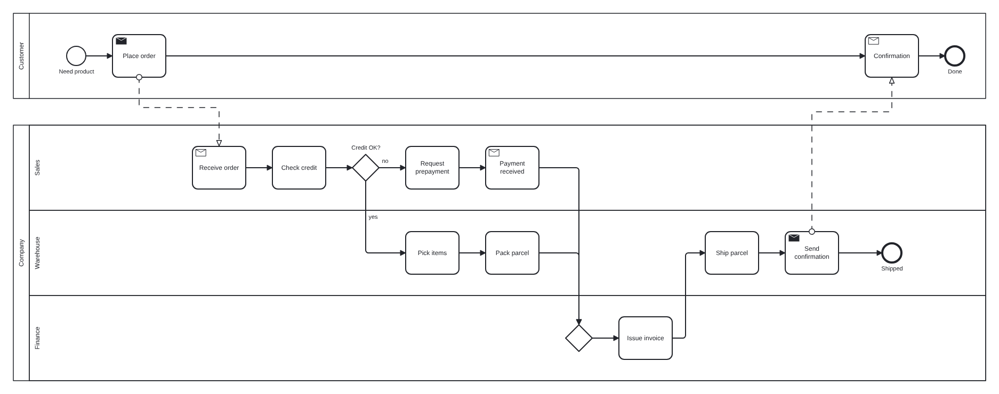

---

## 1. Design principles

1. **Story order.** Steps are written in the order they occur. Every step
   flows into the next one unless you say otherwise.
2. **Few arrows.** You only write `->` for jumps, such as loops or skipping
   ahead. Gateways split and join automatically.
3. **Names are references.** Any step can be referred to by its name, with no
   IDs needed. `@id` is available when names are ambiguous.
4. **Forgiving, precise errors.** Mistakes produce diagnostics with line and
   column numbers, an explanation and, where possible, a suggested fix.
5. **Deterministic output.** The same input always produces the same XML,
   with stable IDs, so generated `.bpmn` files diff cleanly in git.

---

## 2. Lexical structure

| Item | Rule |
|---|---|
| Encoding | UTF-8. LF and CRLF line endings are both accepted. |
| Indentation | Spaces only (a tab is an error with a quick fix). Any consistent increase opens a block, as in Python. The canonical style is 2 spaces. |
| Comments | `#` to the end of the line, when at line start or preceded by whitespace, and not inside a string, an attribute list `[...]` (so `[color: #1F4E79]` works) or `doc` text. |
| Strings | `"..."` with escapes `\"`, `\\`, `\n` (line break in a label). |
| Bare names | Unquoted text running to the end of the line or to the first *terminator* (`->`, `-(`, `~>`, `~(`, `@`, `[`, ` #`, or a trailing `:` in branch position). Leading and trailing whitespace is trimmed. |
| IDs | `@` followed by `[A-Za-z_][A-Za-z0-9_-]*`. |
| Blank lines | Ignored. They never end a block. |

**Quote a name when** it contains a terminator, ends with `:` inside a gateway,
or starts with a keyword and is used as a reference (see §6.2).

```bpmnt
task "Check stock -> reserve"     # contains "->", so it must be quoted
task Check stock                  # bare name "Check stock"
task "Line one\nLine two"         # two-line label
```

---

## 3. Document structure

```text
document   := directive* ( (pool | message-flow)+ | body )
directive  := 'title' NAME
            | 'option' KEY VALUE
pool       := 'pool' NAME attrs? NEWLINE INDENT body DEDENT
            | 'pool' NAME '[collapsed]'
body       := statement*
```

* **No `pool`:** the document is a single process. If it uses `lane`, an
  implicit pool named after the `title` (or "Process") is created, because
  BPMN tools only draw lanes inside a participant.
* **One or more pools:** the document is a *collaboration*. Each expanded pool
  has its own process. Pools are drawn top to bottom in document order.
* **Collapsed pool (black box):** `pool Bank [collapsed]` has no body. It can
  only be the source or target of message flows.

### Directives

| Directive | Meaning |
|---|---|
| `title "Name"` | Name of the collaboration/process and the default output filename. |
| `option xor-join gateway` | Default. Open XOR branches merge through an inserted XOR gateway. |
| `option xor-join direct` | Open XOR branches connect straight to the next step (implicit merge). |

---

## 4. Elements

Every element statement has the same shape:

```text
<keyword> [<name>] [@id] [[attributes]] [<flow tail>]
```

### 4.1 Events

| Notation | BPMN element |
|---|---|
| `start [name]` | None start event |
| `start message\|timer\|signal\|conditional [name]` | Typed start event |
| `start error\|escalation\|compensation [name]` | Start event of an event subprocess (§8.1) |
| `end [name]` | None end event |
| `end message\|signal\|error\|escalation\|compensation\|terminate [name]` | Typed end event |
| `catch message\|timer\|signal\|conditional\|link [name]` | Intermediate catch event |
| `throw message\|signal\|escalation\|compensation\|link [name]` | Intermediate throw event |
| `wait <name>` | Shorthand for `catch timer <name>`, e.g. `wait 3 days` |

**Shared definitions.** Message, signal, error and escalation events of the
same type and name, anywhere in the document, refer to one definition: a
root-level `bpmn:message`, `bpmn:signal`, `bpmn:error` or `bpmn:escalation`,
with an ID such as `Error_payment_failed`. This needs no extra syntax, and it
is how a modelling tool can show that the error a subprocess throws is the one
its boundary event catches.

<!-- screenshot: notation-shared-error -->

```bpmnt
start
sub Take payment
  start
  service Charge card
  end error Payment failed
  on error Payment failed -> task Ask for another card -> end Payment refused
end Paid
```

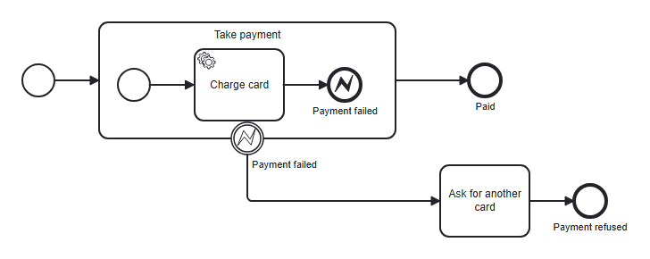

* **A different label.** When an event's label differs from the definition,
  name the definition with an attribute: `[message: Order]`, `[signal: …]`,
  `[error: …]` or `[escalation: …]`. On an event of another type or any
  other element, the attribute has no effect (warning **BT105**).
* **Unnamed events** have no definition. An unnamed `on error` catches any
  error.
* **Send and receive tasks** refer to a message only through `[message: …]`,
  because their names usually describe the work rather than the message.
* **Message flows** carry a `messageRef` when their ends refer to one message,
  or are a send and a receive task with the same name.
* **Nothing to catch or throw.** An error or escalation boundary on a `sub`
  whose body never throws it is **BT305**. An error or escalation thrown inside
  a `sub` that nothing around it catches is **BT306**. Both are information
  only, since the diagram is still valid.

**Link events** are an off-page connector: `throw link Name` jumps to `catch
link Name` without a line across the diagram. Use them when a flow would
otherwise cross most of a large diagram.

<!-- screenshot: notation-link -->

```bpmnt
start Order received
task Check order
throw link To shipping

catch link To shipping
task Ship
end Shipped
```

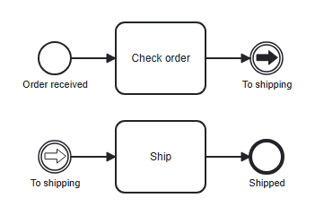

* **Pairing.** A throw and a catch pair by name, ignoring case and repeated
  spaces, within one *process level*: a pool or process body, or one `sub`
  body. Several throws can lead to one catch, but a name can have only one
  catch (error **BT262**).
* **Flow.** Implicit flow stops at a link throw and never enters a link catch
  (§5). An explicit flow out of a throw or into a catch is error **BT263**.
* **Unpaired events.** A throw without a catch is warning **BT260**, and a
  catch without a throw is warning **BT261**.
* **BPMN output.** Both events get a `linkEventDefinition` with the same
  `name`, joined by `target` and `source` references.

### 4.2 Activities

| Notation | BPMN element |
|---|---|
| `task <name>` | Task (abstract) |
| `user <name>` | User task |
| `service <name>` | Service task |
| `script <name>` | Script task |
| `send <name>` | Send task |
| `receive <name>` | Receive task |
| `manual <name>` | Manual task |
| `rule <name>` | Business rule task |
| `call <name>` | Call activity |
| `sub <name>` + block | Embedded subprocess (§8) |
| `sub <name> [event]` + block | Event subprocess (§8.1) |
| `sub <name> [adhoc]` + block | Ad-hoc subprocess (§8.2) |

Activity markers are given as attributes:

| Attribute | Marker |
|---|---|
| `[loop]` | Standard loop |
| `[parallel]` | Parallel multi-instance |
| `[sequential]` | Sequential multi-instance |

Each keyword draws its own task icon, and markers sit at the bottom of the
shape:

<!-- screenshot: notation-activities -->

```bpmnt
start
user Approve order
service Charge card [loop]
manual Pack parcel [parallel]
call Arrange delivery [sequential]
end
```

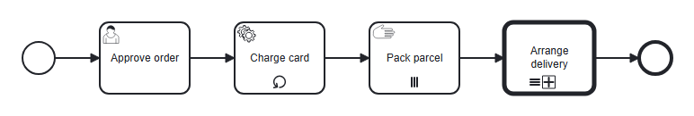

### 4.3 Gateways

| Notation | BPMN element |
|---|---|
| `xor [name]` | Exclusive gateway |
| `and [name]` | Parallel gateway |
| `or [name]` | Inclusive gateway |
| `event [name]` | Event-based gateway |
| `complex [name]` | Complex gateway (§7.5) |

A gateway is usually followed by a block of branches (§7). Without one it is a
plain node that jumps can target (§7.3).

Gateways can be nested. Each one merges its own open branches first (§7.1):

<!-- screenshot: notation-gateways -->

```bpmnt
start
xor Order size?
  small: task Post parcel
  large:
    and
      - task Book courier
      - task Print labels
end
```

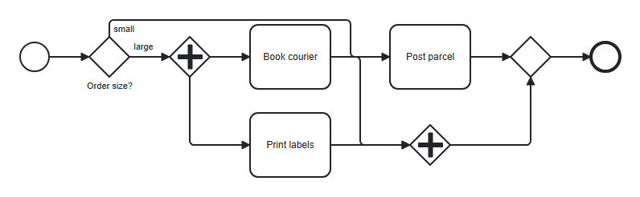

`fork` takes the same branch block but draws **no** gateway (§7.4).

### 4.4 Data and annotations

| Notation | BPMN element |
|---|---|
| `data <name> [collection]?` | Data object reference (optional; data objects are also created automatically on first use) |
| `store <name>` | Data store reference |
| `note <text>` | Text annotation, associated with the **preceding** element |
| `[reads: A, B]` on an activity | Data input associations from A, B |
| `[writes: C]` on an activity | Data output association to C |

<!-- screenshot: notation-data -->

```bpmnt
store Inventory
task Check stock [reads: Inventory, writes: Stock report]
note Uses the nightly snapshot, not live stock
```

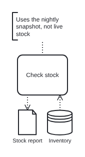

**Data states.** `Name (state)` refers to the data object `Name` in that state,
in `reads:`, `writes:` and `data`. Each state used draws its own shape, with
the state under the name, and all of them are the same data object. This shows
a document moving through a process.

<!-- screenshot: notation-data-states -->

```bpmnt
start
task Draft invoice [writes: Invoice (draft)]
user Approve invoice [reads: Invoice (draft), writes: Invoice (approved)]
service Send invoice [reads: Invoice (approved), writes: Invoice (sent)]
end
```

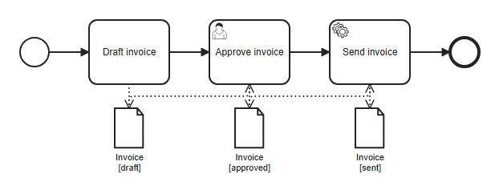

* **One object.** `[collection]` on any `data` line applies to the data object,
  and so to all its states. `data Invoice [collection]` declares the object
  without drawing a shape of its own once the object is used in some state.
* **Literal brackets.** Quote a name whose brackets are part of it:
  `[writes: "Invoice (copy)"]`. A data object is named without its state, so
  `Invoice (draft)` and `Invoice` are one object.
* **Data stores** have no state. `(state)` on a store is warning **BT105**.
* **BPMN output:** one `dataObject`, and one `dataObjectReference` with a
  `dataState` per state. Because bpmn-js draws only the name of a reference, its
  `name` also holds the state, as `Invoice` and `[draft]` on two lines.

### 4.5 Attributes

Attributes are written in square brackets after the name, separated by commas.
There are two forms:

* A **flag** has no value: `[collapsed]`.
* A **key/value** attribute uses `:`, and a key can take several values
  separated by commas: `[reads: A, B]`.

An item of the form `key:`, or one of the flags in the table below, ends a value
list and starts the next attribute. So `[reads: A, B, loop, writes: C]` reads A
and B, sets `loop` and writes C. Quote a value that is spelt like a flag:
`[reads: "loop"]`.

<!-- screenshot: notation-attributes -->

```bpmnt
store Order system
pool Shop
  lane Sales
  start
  user Approve order @approve [parallel, reads: Order, Order system, writes: Decision, doc: "Two people must agree"]
  task Audit [lane: Finance, color: orange]
  end
```

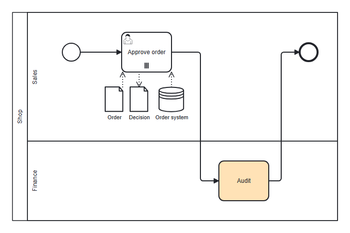

| Attribute | Form | Applies to | Meaning |
|---|---|---|---|
| `id: x` | key/value | any element | Same as `@x` |
| `loop` | flag | activities | Standard loop marker |
| `parallel`, `sequential` | flag | activities | Multi-instance markers; on an ad-hoc `sub`, its ordering (§8.2) |
| `reads: …`, `writes: …` | key/value | activities, events | Data associations (§4.4) |
| `collapsed` | flag | `sub`, `pool` | Collapsed subprocess / black-box pool |
| `event` | flag | `sub` | Event subprocess (§8.1) |
| `adhoc` | flag | `sub` | Ad-hoc subprocess (§8.2) |
| `non-interrupting` | flag | `on`, `start` in an event subprocess | Dashed event, which leaves the activity or parent running |
| `collection` | flag | `data` | Collection data object |
| `fit` | flag | `group` | The box hugs its members rather than spanning the pool (§9.1) |
| `lane: X` | key/value | flow nodes in a pool with lanes | Place this element in lane X without switching (§9) |
| `rule: …` | key/value | `complex` | Activation rule, as documentation (§7.5) |
| `message: x`, `signal: x`, `error: x`, `escalation: x` | key/value | events of that type; `message` also on send and receive tasks | The shared definition this refers to (§4.1) |
| `doc: "…"` | key/value | any element, pool, lane, group | Documentation (§4.6) |
| `color: c` | key/value | any element, pool, lane, group | Fill colour (§4.7) |
| `stroke: c` | key/value | any element, pool, lane, group | Border/line colour (§4.7) |

Unknown attributes produce warning **BT103**, not an error. They are kept on the
model for the extension hook ([architecture §9](architecture.md)). A known
attribute that cannot apply can be warning **BT105**.

### 4.6 Documentation

`doc` attaches text to the **preceding** element as `bpmn:documentation`.
BPMN tools show it in their properties panel, and it stays in the `.bpmn`
file.

```bpmnt
service Validate order
doc Checks every order line against the product catalogue and rejects unknown items.
```

* **Raw text.** In `doc <text>`, everything after `doc ` to the end of the
  line is raw text. `#`, `->` and quotes have no special meaning there.
* **Several `doc` lines** in a row are joined with line breaks.
* **Block form:** `doc` with nothing after it, followed by an indented block.
  The block is raw text: nothing in it is parsed, and blank lines become
  paragraph breaks.

  ```bpmnt
  service Reserve stock
  doc
    Reserves the ordered quantities in every warehouse that holds
    the items, preferring the warehouse closest to the customer.

    Exception: if no stock is available -> the order is back-ordered.
  ```

* **Placement.** A `doc` before the first element of a pool, group or `sub`
  body documents that container. A `doc` before the first element of the
  file documents the process or collaboration.
* `[doc: "…"]` is the one-line attribute equivalent.
* Like notes, `doc` lines do not interrupt implicit flow.

This is the whole of a documented process. `doc` draws nothing, so the diagram
looks the same with or without it:

<!-- screenshot: notation-doc -->

```bpmnt
doc Handles orders from the web shop.
start Order received
service Validate order
doc Checks every order line against the product catalogue.
end Order valid
```

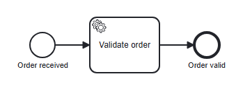

### 4.7 Colours

`[color: …]` sets the fill and `[stroke: …]` sets the border and text
colour. They can be used on elements, pools, lanes and groups.

<!-- screenshot: notation-colours -->

```bpmnt
lanes Sales [color: #1F4E79], Warehouse [color: green]
lane Sales
task Escalate [color: #FFE0E0, stroke: red]
```

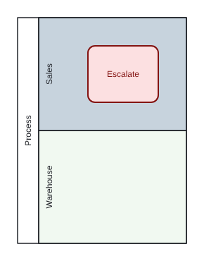

* **Values:** `#RRGGBB`, `#RGB`, or a named colour from the bpmn-js palette
  (`blue`, `orange`, `green`, `red`, `purple`) or CSS names. An invalid value
  is error **BT104**.
* **Output:** both the OMG *BPMN in Color* attributes
  (`color:background-color` / `color:border-color`) and the bpmn-js `bioc:`
  attributes, so the colours survive in Camunda Modeler, bpmn.io and other
  tools.
* **Lane colour** fills the whole lane band. BPMN DI has no way to colour
  only the lane header.
* **Lane attributes** may be given wherever the lane is named (`lanes`,
  `lane`). Conflicting values are warning **BT251**, and the last one wins.

### 4.8 Collapsed subprocess placeholders

`sub <name> [collapsed]` **without a body** is allowed. It draws a collapsed
subprocess whose detail is documented elsewhere, for example *"Credit
check"*. Use `call` instead if it refers to a reusable process.

<!-- screenshot: notation-placeholder -->

```bpmnt
start
sub Credit check [collapsed]
call Arrange delivery
end
```

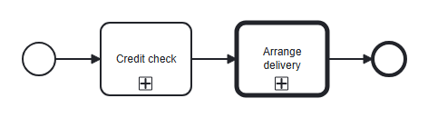

---

## 5. Sequence: implicit flow

Within a block (a pool body, a branch or a subprocess body), **each flow node
is connected to the next flow node in the same block**.

<!-- screenshot: notation-implicit-flow -->

```bpmnt
start Order received
task Check order          # Order received -> Check order
task Ship                 # Check order -> Ship
end Done                  # Ship -> Done
```

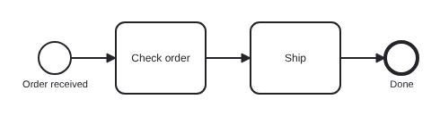

Implicit flow **does not** leave:

* an **end event** or a **link throw event** (§4.1);
* a line whose last element is a **reference** (a jump, §6.2);
* a **gateway**, whose outgoing flows are its branches (§7).

Lane switches (§9), notes, `doc` lines, data and store declarations, group
blocks (§9.1) and message flows do **not** interrupt implicit flow.

**Start events.** Implicit flow **never enters a start event**. A `start` in
the middle of a block begins a new, independent chain. If the element before
it is still open (not an end event, jump or gateway), that element gets
warning **BT302 dead end**. Close it with an `end` or a jump. The same holds
for a **link catch event** (§4.1), which also begins a new chain.

<!-- screenshot: notation-start-chains -->

```bpmnt
pool Company
  lane Sales
  start timer Monthly planning
  user Create order
  end message Order issued        # closes the first chain
  lane Field service
  start timer Visit day           # new chain; nothing flows into it
  user Install equipment
```

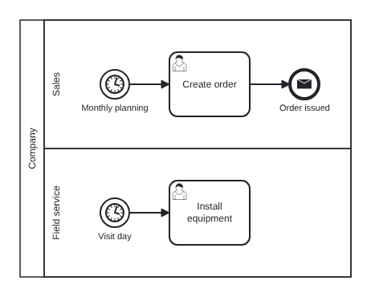

**End of a block.** Open ends left at the end of a pool or `sub` body are
dead ends (BT302). Open ends at the end of a branch are open branches (§7.1).

---

## 6. Explicit flows

### 6.1 Chains

An arrow after an element declares a flow to the element on its right. If the
right-hand side starts with an element keyword, it **declares a new element
inline**:

```bpmnt
task Pick items -> task Pack parcel -> end Packed
```

The last element of a chain continues implicitly to the next line, unless it
is an end event or a reference.

<!-- screenshot: notation-chain -->

```bpmnt
start
task Pick items -> task Pack parcel -> service Book courier
task Ship
end
```

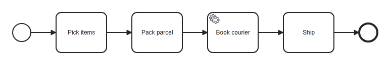

### 6.2 References (jumps)

If the right-hand side does **not** start with a keyword, it is a **reference**
to an existing element, which may be declared before or after:

<!-- screenshot: notation-jump -->

```bpmnt
task Check order
task Fix order
-> Check order            # loop back; nothing flows implicitly to the next line
```

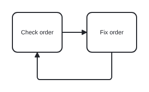

A line made of only `-> Target` creates a flow from the previous element to
`Target`.

**Several targets.** A jump can name several targets separated by commas.
Each one gets its own flow from the same source, with **no gateway**:

<!-- fragment -->

```bpmnt
service Publish order -> Update billing, Update CRM
-> Retry, Notify operator          # standalone form, from the previous element
```

Several flows into one element (an uncontrolled merge) need no special
syntax. Just jump to it from each source. For splits that *continue in story
order*, use `fork` (§7.4).

**Name resolution**

1. `@id` matches an element ID exactly.
2. Otherwise the name is matched against element names, ignoring case and
   collapsing repeated whitespace.
3. If more than one element matches, the result is error **BT201 Ambiguous
   reference**, listing the candidates with their line numbers. Fix it with
   `@id`.
4. A reference whose first word is a keyword must be quoted:
   `-> "end of month run"`.
5. Sequence flows cannot cross pools (error **BT210**). Use a message flow.

**In practice**

Forward references work: the target can be declared later in the file, as `Ship
parcel` is here. On a branch line, a name that does not start with a keyword is a
jump.

<!-- screenshot: notation-forward-reference -->

```bpmnt
start
xor Ready?
  yes: Ship parcel
  no: task Prepare parcel
task Ship parcel
end
```

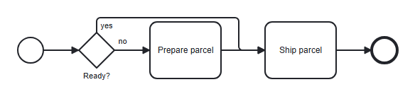

* **Names are forgiving.** Case and repeated spaces do not matter, so
  `-> check  order` finds `task Check order`.
* **`@id` settles duplicates.** Give the element you mean an `@id`, then refer to
  it. An `@id` can contain letters, digits, `_`, `-` and `.`.

  ```bpmnt
  start
  task Check order @first_check
  task Fix order
  task Check order
  xor Good?
    yes: end
    no: @first_check
  ```

* **Quote what would be misread.** A reference is quoted when its first word is a
  keyword (`-> "end of month run"`), or when it contains a terminator (§2). In a
  multi-target jump, a name containing a comma is quoted too:
  `-> "Bill, then ship", Notify`.

**Messages and quick fixes.** When a name matches several elements, you get:

```text
error[BT201]: `Review` is ambiguous: 2 elements have this name (lines 4, 5). Give the one you mean an @id and refer to it by that.
```

When a name matches nothing, the closest one is suggested, and the editors offer
it as a quick fix titled "Change to `Check order`":

```text
error[BT202]: Nothing is called `Chek order`. Did you mean `Check order`?
```

### 6.3 Flow labels

```bpmnt
task A -(after review)-> task B
```

Inside gateways, branch labels (§7) are the normal way to label flows.

<!-- screenshot: notation-flow-label -->

```bpmnt
start
task Draft -(checked)-> task Publish
end
```

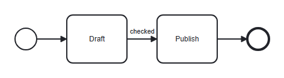

### 6.4 Message flows

`~>` declares a message flow. It never affects sequence flow.

<!-- fragment -->

```bpmnt
send Place order ~> Receive order            # to an element in another pool
send Request payment ~(invoice)~> Bank       # to a (collapsed) pool, with a label
Bank ~> Payment received                     # standalone statement: pool → element
```

* Source and target must be in **different pools** (error **BT211**).
* Either end may be a pool name: the flow attaches to the pool border.
* Standalone `A ~> B` statements may appear anywhere in a pool body or at the
  top level.

<!-- screenshot: notation-message-flows -->

```bpmnt
pool Shop
  start
  send Request payment ~(card details)~> Bank
  receive Payment received
  end

pool Bank [collapsed]
Bank ~> Payment received
```

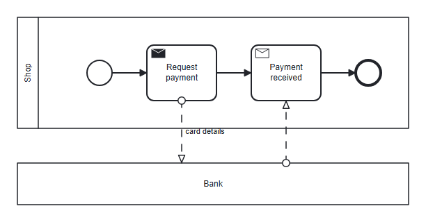

### 6.5 Generated IDs

You meet IDs in the `.bpmn` output, in `sourceMap` and in tools. They are built
from names, so the same source always gives the same IDs, and generated files diff
cleanly.

<!-- screenshot: notation-ids -->

```bpmnt
start Order received
task Check order [writes: Order (checked)]
xor Valid?
  yes: task Ship
  no: task Reject
end
```

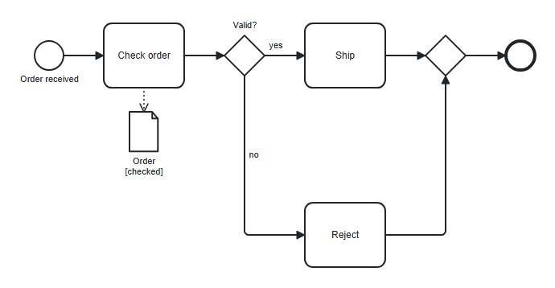

This gives `Event_order_received`, `Activity_check_order`, `Gateway_valid`,
`Activity_ship`, `Activity_reject`, `Gateway_join_after_end_1`, `Event_end_1`,
`Flow_order_received__check_order` and `DataObjectReference_order_checked`.

| Element | ID | Example |
|---|---|---|
| Event, activity, gateway | Prefix and name | `Event_order_received`, `Activity_check_order`, `Gateway_valid` |
| Unnamed event or gateway | Prefix, kind and a count | `Event_start_1`, `Gateway_and_1` |
| Unnamed, inside a `sub` | With the `sub`'s name | `Event_handle_payment_start_1` |
| Unnamed boundary event | Its host and a count | `Event_approve_request_boundary_1` |
| Inserted join | What it leads into | `Gateway_join_after_ship` |
| Sequence flow | Both ends | `Flow_check_order__valid` |
| Message flow | Both ends | `MessageFlow_place_order__order_received` |
| Pool and its process | The pool's name | `Participant_company`, `Process_company` |
| Lane, group | The name | `Lane_sales`, `Group_fulfilment` |
| Data | The name, and any state | `DataObject_order`, `DataObjectReference_order_checked` |
| Shared definition | The type and name | `Message_order`, `Error_payment_failed` |
| Note | Its element | `TextAnnotation_check_order` |

* **The name part** is lower case, with accents removed and everything other than
  letters and digits turned into `_`.
* **Clashes.** Elements with one name get `_2`, `_3` and so on in document order.
  When pools clash, the pool's name goes in on every side, as
  `Activity_customer_check` and `Activity_shop_check`, so reordering pools changes
  no IDs.
* **`@id`** is used unchanged. Renaming an element changes its generated ID, so use
  `@id` where something outside the file relies on it.

---

## 7. Gateways and branches

A gateway is followed by an indented block of **branches**:

| Branch form | Meaning |
|---|---|
| `label:` | Labelled branch (condition name on the flow) |
| `"label with: colon":` | Labelled branch, quoted |
| `-` | Unlabelled branch (typical for `and`) |
| `else:` | Default flow (XOR, OR and complex only) |

A branch is either **inline**, with a chain on the same line, or a **block**
on the following lines. It can also be both:

<!-- screenshot: notation-branches -->

```bpmnt
xor Approved?
  yes: task Ship -> end Shipped          # inline
  no:                                    # block
    task Notify customer
    end Rejected
```

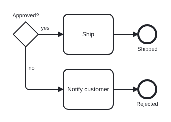

### 7.1 Automatic joins

A branch is **open** if its last element would continue implicitly, meaning it
is not an end event and not a jump. An **empty** branch (`no:` with nothing
after it) is also open and connects the split directly to the join.

When the gateway block ends, the open branches are merged into **the next
statement after the block**:

| Split | Open branches | Result |
|---|---|---|
| any | 0 | Nothing joins. The next statement needs another incoming flow (or BT301 unreachable warning). |
| any | 1 | A direct flow, with no join gateway. |
| `and` | ≥2 | An inserted **parallel** join gateway. |
| `or` | ≥2 | An inserted **inclusive** join gateway. |
| `xor`, `event` | ≥2 | An inserted **exclusive** join gateway (or direct flows with `option xor-join direct`). |
| `complex` | ≥2 | An inserted **complex** join gateway, since the compiler does not know the split's rule. |

The inserted join is placed in the lane in effect at the next statement (§9).

<!-- screenshot: notation-and-join -->

```bpmnt
and
  - task Pick items
  - task Print invoice
task Ship                    # AND-join inserted before "Ship"
```

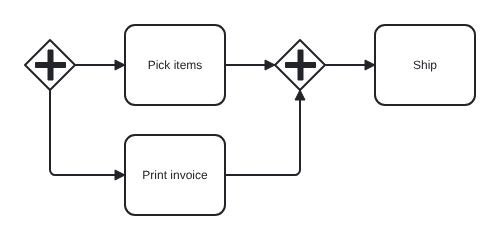

**One example per row of the table.** No open branches: nothing joins, and the
next statement needs another incoming flow. Here a jump gives it one. Without the
jump, `Archive` would be unreachable (BT301).

<!-- screenshot: notation-join-none -->

```bpmnt
start
xor Approved?
  yes:
    task Ship
    -> Archive
  no: end Rejected
task Archive
end
```

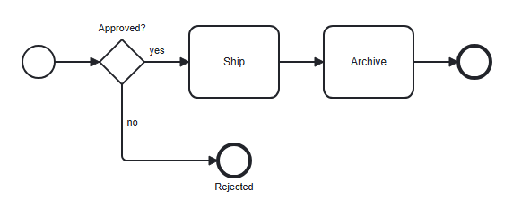

One open branch: a direct flow, with no join.

<!-- screenshot: notation-join-one -->

```bpmnt
start
xor Approved?
  yes: task Ship
  no: end Rejected
end Shipped
```

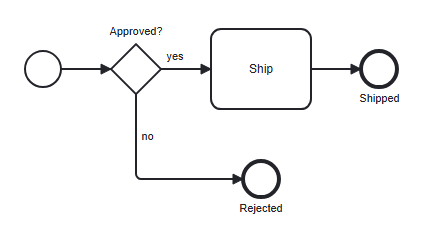

Two or more open `or` branches: an inclusive join.

<!-- screenshot: notation-join-or -->

```bpmnt
start
or Extras?
  gift: task Wrap gift
  card: task Write card
task Ship
end
```

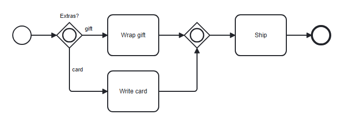

Two or more open `xor` branches: an exclusive join.

<!-- screenshot: notation-join-xor -->

```bpmnt
start
xor Express?
  yes: task Book courier
  no: task Book post
task Ship
end
```

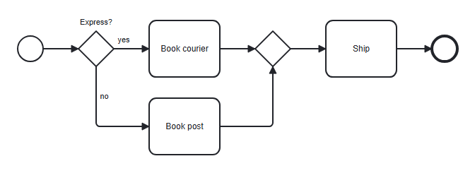

The same, with `option xor-join direct`: both branches flow straight in.

<!-- screenshot: notation-join-direct -->

```bpmnt
option xor-join direct
start
xor Express?
  yes: task Book courier
  no: task Book post
task Ship
end
```

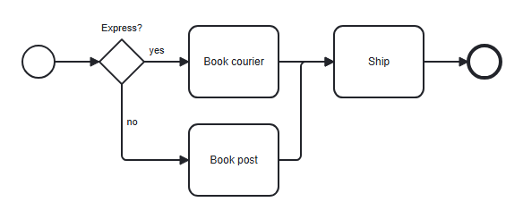

The `and` row is shown above, and the `complex` row in §7.5.

**Nested splits.** Joins are built from the innermost split outwards. An `and`
inside an `xor` branch gets its own parallel join first, and that join is then one
open end of the `xor`:

<!-- screenshot: notation-join-nested -->

```bpmnt
start
xor Express?
  yes:
    and
      - task Pick items
      - task Book courier
  no: task Post parcel
task Send confirmation
end
```

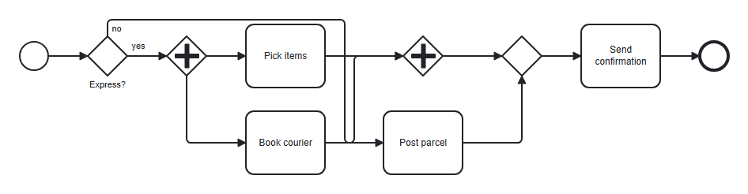

**Empty branches.** A branch with nothing in it is open, so it runs straight from
the split to the join:

<!-- screenshot: notation-join-empty -->

```bpmnt
start
xor Gift wrapping?
  yes: task Wrap gift
  no:
task Ship
end
```

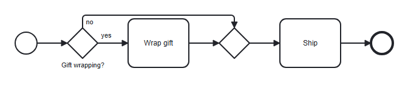

**A `start` after a block.** Implicit flow never enters a start event, so open
branches do not merge into it. Each one is left as a dead end (BT302). End them, or
move the `start` further down.

<!-- screenshot: notation-join-start -->

```bpmnt
start Morning
xor Busy?
  yes: task Call in help
  no: task Open alone
start Evening
task Count takings
task Close shop
task Lock up
end
```

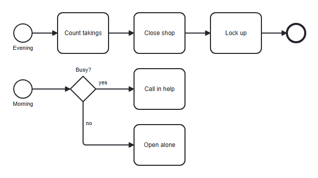

### 7.2 Event-based gateways

Every branch of `event` must start with a catch event or a receive task
(error **BT220** otherwise):

<!-- screenshot: notation-event-gateway -->

```bpmnt
event Wait for reply
  - catch message Payment received -> task Ship
  - wait 14 days -> end Cancelled
```

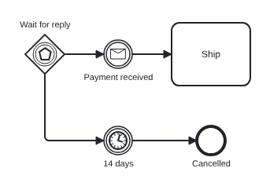

### 7.3 Explicit gateways

For merges that are not well structured, declare a gateway with an ID and
jump to it:

```bpmnt
xor Merge @m
```

A gateway with no branch block is a plain node. Jumps (`-> @m`) can target it,
and implicit flow continues out of it.

<!-- screenshot: notation-explicit-gateway -->

```bpmnt
start
xor Customer type?
  new:
    task Create account
    -> @merge
  existing:
    task Check details
    -> @merge
xor Merge @merge
task Take payment
end
```

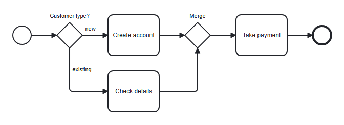

### 7.4 Fan-out without a gateway: `fork`

`fork` uses the same branch syntax as `and`, but **no gateway is drawn**.
Each branch starts with a flow straight from the preceding element. This is
an *uncontrolled split*: all branches run in parallel.

<!-- screenshot: notation-fork -->

```bpmnt
lane Orders
service Publish order
fork
  -
    lane Billing
    service Update billing
    -> Sync done
  -
    lane CRM
    service Update CRM
    -> Sync done
xor Sync done
```

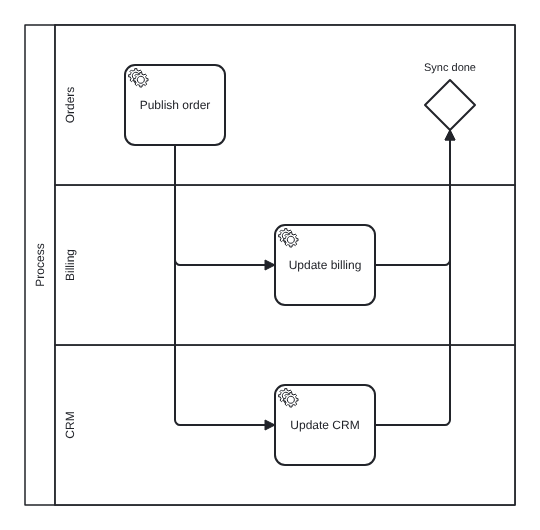

* Branches may be unlabelled (`-`) or labelled. A label goes on the flow,
  but there are no conditions and no `else:` (BT221).
* **Joins.** Open `fork` branches join like `and` branches (§7.1), with an
  inserted **parallel** join when there are two or more. This keeps the
  model semantically correct. To avoid the inserted join, end each branch
  with a jump to an element of your choice, as above.
* A `fork` must follow an element that implicit flow leaves. A `fork` right
  after an end event, a jump, or a gateway block with no open branches is
  error **BT224**.

### 7.5 Complex gateways

`complex` is for a split or merge whose rule is not exclusive, parallel or
inclusive, such as "continue when 2 of the 3 reviewers have responded". It is
rare and often discouraged, so state the rule where the reader can see it.

<!-- screenshot: notation-complex -->

```bpmnt
start
complex Enough reviews? [rule: Continue when 2 of the 3 reviews are in]
  - user Review A
  - user Review B
  - user Review C
task Decide
end
```

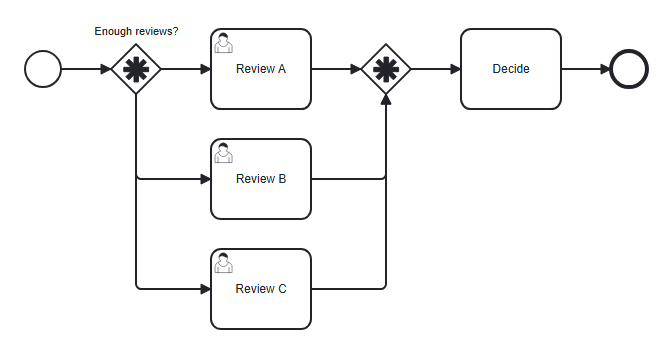

* **Branches** are written as for `and`: bullets or labels, and `else:` for a
  default flow.
* **Joins.** Open branches merge through an inserted **complex** join (§7.1).
* **The rule.** `[rule: …]` is written as the gateway's `bpmn:documentation`,
  like `doc`. It is not an `activationCondition`, because condition expressions
  are out of scope (ADR-008). On any other element it is warning **BT105**.

---

## 8. Subprocesses

<!-- screenshot: notation-subprocess -->

```bpmnt
sub Handle payment
  start
  service Charge card
  xor Charged?
    yes: end Paid
    no:  end error Payment failed
```

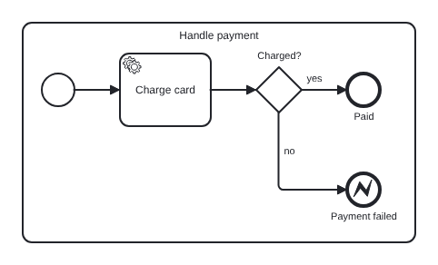

* The block is the subprocess body, with its own implicit flow scope.
* `sub Handle payment [collapsed]` draws a collapsed subprocess. The body is
  still modelled and is shown on a separate diagram plane (drill-down in
  bpmn-js).
* Jumps cannot cross a subprocess boundary (error **BT212**).
* Lanes do not apply inside a subprocess. The whole subprocess sits in its
  parent's lane.

### 8.1 Event subprocesses

`sub Name [event]` is a subprocess started by an event while its parent runs,
such as "if the customer cancels at any point". Write it in a `sub` body or
directly in a pool body. It is not part of the story: implicit flow passes it
by, so it can go anywhere in the block.

<!-- screenshot: notation-event-subprocess -->

```bpmnt
start
sub Handle order
  start
  task Pick items
  task Ship
  end
  sub Cancellation [event]
    start message Order cancelled
    task Refund customer
    end
sub Late delivery [event]
  start timer One week [non-interrupting]
  task Apologise
  end
end Order finished
```

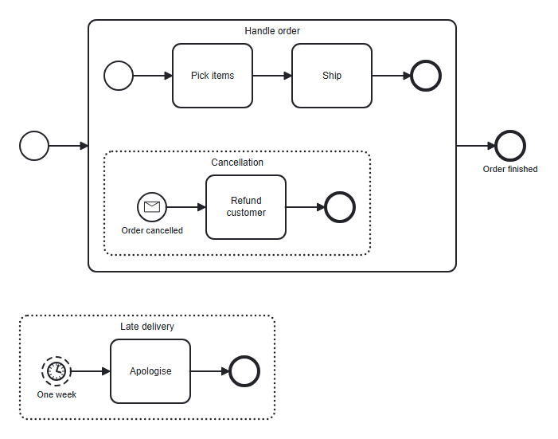

* **Start event.** It has exactly one start event, which must be typed
  (error **BT270**): `message`, `timer`, `signal`, `conditional`, `error`,
  `escalation` or `compensation`. The last three are allowed only here; on any
  other `start` they are error **BT102**.
* **Interrupting.** An event subprocess stops its parent unless its start event
  is `[non-interrupting]`. Error and compensation starts always interrupt
  (error **BT240**).
* **No flows.** A flow into or out of an event subprocess is error **BT271**, and
  a boundary event on it is error **BT240**.
* **Layout.** It is drawn below its parent's main flow, in the lane it was
  written in, with a dotted border. `[event, collapsed]` has task size, with
  the body on a plane of its own.
* **Groups.** Being outside the flow, it takes no column, so it does not join a
  group it is written in.

### 8.2 Ad-hoc subprocesses

`sub Name [adhoc]` is a set of activities performed in any order, any number of
times, until the work is complete. BPMN draws it with a tilde marker.

<!-- screenshot: notation-adhoc -->

```bpmnt
start
sub Prepare proposal [adhoc]
  task Research customer
  task Draft sections
  task Gather quotes
  task Check the budget
  task Review wording -> task Publish draft
end Proposal ready
```

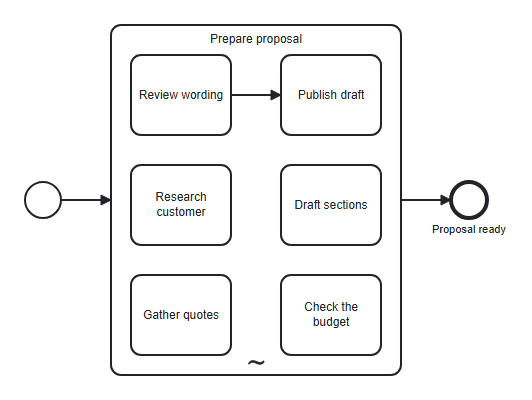

* **No implicit flow inside.** Activities are listed, not chained, so they need
  no start or end event, and BT301 and BT302 do not apply to its body. A start
  or end event inside is error **BT280**, because BPMN does not allow them.
* **Explicit flows are allowed** for the occasional ordering constraint, as with
  `Review wording` and `Publish draft` above. A chain, a gateway's branches and a
  boundary event's chain inside keep their usual flow.
* **Ordering.** `[parallel]` is the default, or `[sequential]` for one activity at
  a time. These set the subprocess's `ordering`, not a multi-instance marker.
* **Layout.** Activities that no flow connects go in a compact grid, in document
  order, below any that are connected. `[adhoc, collapsed]` has task size, with
  the tilde marker.
* A subprocess cannot be both `adhoc` and `event` (**BT280**).

---

## 9. Pools and lanes (lane switches)

Inside a pool, `lane <name>` **switches the current lane**. Every following
element is placed in that lane until the next switch. Implicit flow continues
across lane switches, so a process reads as one story.

<!-- screenshot: notation-lanes -->

```bpmnt
pool Company
  lane Sales
  receive Order received
  task Check credit           # Sales
  lane Warehouse
  task Pick items             # Warehouse; Check credit -> Pick items
```

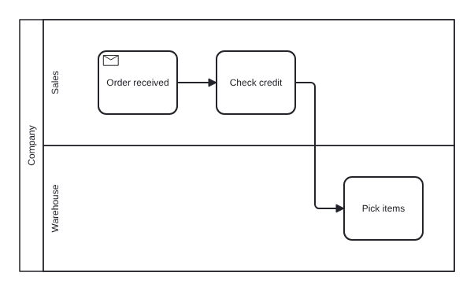

**Rules**

1. **Scoping.** A lane switch inside a gateway branch or boundary chain lasts
   until the end of that branch. After the block, the lane in effect *before
   the gateway* is restored.
2. **First lane.** In a pool that uses lanes, an element before the first
   `lane` line is error **BT230**, with the quick fix "insert `lane …` above".
3. **Lane order.** Lanes are drawn top to bottom in order of first
   appearance. You can override this with `lanes Sales, Warehouse, Finance` at
   the top of the pool body.
4. **Inline override.** `task Audit [lane: Finance]` places one element in
   another lane without switching.
5. **Nested lanes** (child lane sets) are not supported in v1.
6. **Repeated `lanes`.** `lanes` may appear several times. Each one appends
   lanes in order, which keeps long lane lists readable. Items may carry
   attributes: `lanes Billing [color: green], CRM [color: green]`.

**Lane scoping in practice.** Here both blocks switch lane, and `Confirm order` is
back in Sales because the switches ended with their blocks. `Audit` visits Finance
without switching, and the inserted join is in Warehouse, where the story has
moved to by the time it is needed.

<!-- screenshot: notation-lane-scoping -->

```bpmnt
pool Company
  lanes Sales, Manager, Warehouse, Finance
  lane Sales
  start
  task Take order
    on timer 1 day
      lane Manager
      task Chase order
  task Check stock
  xor In stock?
    yes:
      lane Warehouse
      task Reserve items
    no:
      task Tell customer
  task Confirm order
  task Audit [lane: Finance]
  xor Express?
    yes: task Book courier
    no: task Book post
  lane Warehouse
  task Ship
  end
```

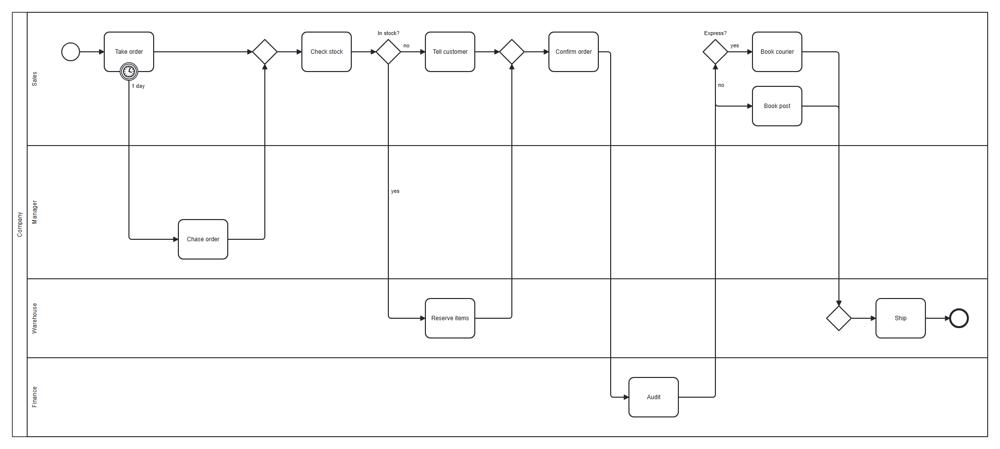

**Where an inserted join goes.** A join is placed in the lane in effect at the
statement after the block. `[lane: X]` on that statement moves only that statement,
so the join stays in the current lane.

### 9.1 Groups

A group is a dashed box around related elements, typically a **phase** of
the process. It is written as a block:

<!-- fragment -->

```bpmnt
pool Company
  group Fulfilment
    lane Sales
    start
    user Create order
    # …
  group After-sales [color: #FFF5F5]
    lane Sales
    start
    user Send satisfaction survey
    # …
```

* **Transparency.** A group block does not create a flow scope or a lane
  scope. Implicit flow and lane switches continue into, through and out of
  the group exactly as if the `group` line were not there. It only marks
  which elements belong to the group.
* **Layout.** Groups are laid out as **consecutive columns**. All elements
  of one group are placed in columns before the elements of the next group
  in document order, and no element outside a group shares its columns. By
  default the box spans the **full height of the pool** (all lanes), as for
  a phase. `[fit]` shrinks the box to the bounding box of its members
  instead.
* **Across pools.** Using the same group name in several pools gives *one*
  group whose box covers its members in all of those pools.
* **Restrictions (v1).** Groups cannot be nested, and an element can belong
  to only one group (BT250). Groups cannot be used inside a `sub`.
* **BPMN output:** a `bpmn:group` with a `categoryValue` (the label), plus a
  DI shape.

<!-- screenshot: notation-groups -->

```bpmnt
pool Company
  lanes Sales, Service
  group Sale
    lane Sales
    start
    user Sign contract
  group Service [color: #FFF5F5]
    lane Service
    user Install
    end
```

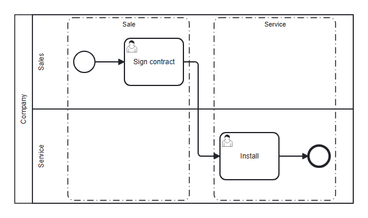

---

## 10. Boundary events

Boundary events are written as `on` lines in an **indented block under an
activity**:

<!-- fragment -->

```bpmnt
user Approve request
  on timer 48 hours -> task Escalate -> end Escalated
  on message Cancelled [non-interrupting]
    task Log cancellation
    -> Archive
```

```text
on <event-type> [name] [@id] [[attributes]] [flow tail]
```

* Event types: `message`, `timer`, `signal`, `error`, `escalation`,
  `conditional`, `compensation`.
* A boundary event refers to the same definition as events of its type and name
  elsewhere (§4.1), so `on error Payment failed` on a `sub` catches the
  `end error Payment failed` inside it.
* Interrupting by default. Add `[non-interrupting]` for a dashed event.
  Error and compensation boundaries are always interrupting (BT240 if marked
  otherwise).
* The boundary chain is a branch. If an **interrupting** boundary chain ends
  **open**, it merges into the host activity's next element through an
  automatic XOR join, as described in §7.1.
* A **non-interrupting** boundary chain must end with an end event or a jump.
  If it ends open, it gets warning **BT241** (instead of BT302) and is not
  merged, because merging it would duplicate the token on the main path.
* For a `sub` with a body, `on` lines may appear anywhere in its block. All
  other lines form the body.

**An interrupting chain that merges back.** The timer stops `Approve request`. Its
chain ends open, so it merges with the main path through an inserted exclusive join.

<!-- screenshot: notation-boundary-merge -->

```bpmnt
start
user Approve request
  on timer 5 days -> user Escalate to manager
task Notify requester
end
```

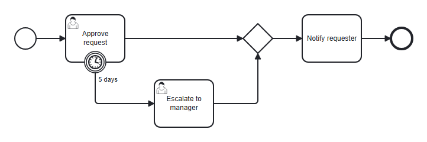

**A non-interrupting chain that must end.** `Approve request` carries on, so this
chain ends on its own. Merging it back would run `Notify requester` twice.

<!-- screenshot: notation-boundary-end -->

```bpmnt
start
user Approve request
  on timer 2 days [non-interrupting] -> send Remind approver -> end Reminded
task Notify requester
end
```

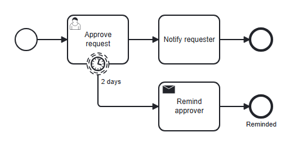

**BT241.** If that chain ends open, it is reported and stays unconnected. Fix it
with an `end`, as above, or a jump.

<!-- expect-error BT241 -->

```bpmnt
start
user Approve request
  on timer 2 days [non-interrupting] -> send Remind approver
task Notify requester
end
```

---

## 11. Diagnostics

Every diagnostic has a stable code, a severity, a source range and, where
possible, a quick fix. From code, `check()` and `compile()` can turn checks off:
`{ rules: { BT304: false } }`. This works for the checks made on the model, which
are BT222, BT240, BT260, BT261, BT262, BT270, BT280 and BT301 to BT306 (see
[architecture §10](architecture.md)).

| Code | Severity | Meaning |
|---|---|---|
| BT001 | error | Syntax error (unexpected token / malformed statement) |
| BT002 | error | Tab used for indentation |
| BT003 | error | Inconsistent dedent (does not match any open block) |
| BT004 | error | Unterminated string |
| BT101 | error | Unknown keyword (with "did you mean …?") |
| BT102 | error | Event type not allowed here (e.g. `start terminate`) |
| BT103 | warning | Unknown attribute |
| BT104 | error | Invalid colour value |
| BT105 | warning | Attribute has no effect on this element |
| BT201 | error | Ambiguous reference |
| BT202 | error | Unknown reference (with closest-name suggestion) |
| BT203 | error | Duplicate `@id` |
| BT210 | error | Sequence flow crosses pools |
| BT211 | error | Message flow within one pool |
| BT212 | error | Flow crosses subprocess boundary |
| BT220 | error | Invalid branch start for event-based gateway |
| BT221 | error | `else:` on a parallel or event-based gateway |
| BT222 | warning | Gateway with a single branch |
| BT224 | error | `fork` without an open preceding element |
| BT230 | error | Element before first lane in a pool with lanes |
| BT240 | error | Invalid boundary or event subprocess event configuration |
| BT241 | warning | Non-interrupting boundary chain ends open |
| BT250 | error | Nested group, element in two groups, or group inside a `sub` |
| BT251 | warning | Conflicting lane attributes |
| BT260 | warning | Link throw event without a matching catch |
| BT261 | warning | Link catch event without any throw |
| BT262 | error | Two link catch events with the same name in one process level |
| BT263 | error | Explicit flow out of a link throw or into a link catch |
| BT270 | error | Event subprocess without exactly one typed start event |
| BT271 | error | Flow into or out of an event subprocess |
| BT280 | error | Start or end event in an ad-hoc subprocess, or one that is also an event subprocess |
| BT301 | warning | Unreachable element (no incoming sequence or message flow, not a start event) |
| BT302 | warning | Dead end (non-end element with no outgoing flow) |
| BT303 | info | Process has no start or no end event |
| BT304 | info | Send/receive element without a message flow |
| BT305 | info | Error or escalation boundary event with nothing to catch in its subprocess |
| BT306 | info | Error or escalation thrown in a subprocess with nothing to catch it |

### 11.1 Each code, with an example and a fix

Each entry links to the test fixture for that code. A fix is shown where it is not
obvious from the message.

#### BT001

[Fixture](../test/fixtures/diagnostics/BT001-unclosed-attributes.bpmnt). A statement
cannot be read, here because an attribute list is never closed. The rest of the line
is skipped.

<!-- expect-error BT001 -->

```bpmnt
start
task Check order [loop
end
```

Fix: close the list, `task Check order [loop]`.

#### BT002

[Fixture](../test/fixtures/diagnostics/BT002-tab-indent.bpmnt). A tab in the
indentation. The editors offer a quick fix.

<!-- expect-error BT002 -->

```bpmnt
pool Company
	start
  end
```

Fix: indent with spaces.

#### BT003

[Fixture](../test/fixtures/diagnostics/BT003-inconsistent-dedent.bpmnt). A line is
indented less than the block it is in, but not as little as any block around it.

<!-- expect-error BT003 -->

```bpmnt
pool Company
    start
    task Check order
  end
```

Fix: line it up with its block.

```bpmnt
pool Company
    start
    task Check order
    end
```

#### BT004

[Fixture](../test/fixtures/diagnostics/BT004-unterminated-string.bpmnt). A string has
no closing quote.

<!-- expect-error BT004 -->

```bpmnt
start
task "Check order
end
```

Fix: add the quote, `task "Check order"`.

#### BT101

[Fixture](../test/fixtures/diagnostics/BT101-unknown-keyword.bpmnt). A line starts
with a word that is not a keyword. The closest keyword is suggested, with a quick fix.

<!-- expect-error BT101 -->

```bpmnt
start
taks Check order
end
```

Fix: `task Check order`.

#### BT102

[Fixture](../test/fixtures/diagnostics/BT102-start-terminate.bpmnt). This keyword does
not take that event type. §4.1 lists what each one takes.

<!-- expect-error BT102 -->

```bpmnt
start terminate
task Check order
end
```

Fix: move the type to where it applies.

```bpmnt
start
task Check order
end terminate
```

#### BT103

[Fixture](../test/fixtures/diagnostics/BT103-unknown-attribute.bpmnt). The notation
does not define this attribute. It is kept for the extension hook, and otherwise has
no effect.

<!-- expect-error BT103 -->

```bpmnt
start
task Check order [urgent]
end
```

Fix: if it should show, use something defined: `task Check order [color: red]`.

#### BT104

[Fixture](../test/fixtures/diagnostics/BT104-invalid-colour.bpmnt). The colour is not
`#RRGGBB`, `#RGB` or a known name.

<!-- expect-error BT104 -->

```bpmnt
start
task Check order [color: #12345]
end
```

Fix: `task Check order [color: #123456]`.

#### BT105

[Fixture](../test/fixtures/diagnostics/BT105-attribute-without-effect.bpmnt). This
attribute exists, but does nothing on this element.

<!-- expect-error BT105 -->

```bpmnt
start
task A [message: Order]
end
```

Fix: put it where it applies, or remove it: `send A [message: Order]`.

#### BT201

[Fixture](../test/fixtures/diagnostics/BT201-ambiguous-reference.bpmnt). Several
elements have the name the jump refers to.

<!-- expect-error BT201 -->

```bpmnt
start
task Review
task Review
xor Approved?
  yes: end Done
  no:
    -> Review
```

Fix: give the one you mean an `@id`.

```bpmnt
start
task Review @first
task Review
xor Approved?
  yes: end Done
  no:
    -> @first
```

#### BT202

[Fixture](../test/fixtures/diagnostics/BT202-unknown-reference.bpmnt). Nothing has
this name. The closest one is suggested, with a quick fix.

<!-- expect-error BT202 -->

```bpmnt
start
task Check order
xor OK?
  yes: end Done
  no:
    -> Chek order
```

Fix: `-> Check order`.

#### BT203

[Fixture](../test/fixtures/diagnostics/BT203-duplicate-id.bpmnt). Two elements have
one `@id`.

<!-- expect-error BT203 -->

```bpmnt
start
task Check order @check
task Ship order @check
end
```

Fix: `task Ship order @ship`.

#### BT210

[Fixture](../test/fixtures/diagnostics/BT210-sequence-flow-across-pools.bpmnt). A
sequence flow goes to another pool. Pools talk with messages.

<!-- expect-error BT210 -->

```bpmnt
pool Customer
  start
  task Order -> Receive order

pool Shop
  task Receive order
  end
```

Fix: use a message flow.

```bpmnt
pool Customer
  start
  send Order ~> Receive order
  end

pool Shop
  receive Receive order
  end
```

#### BT211

[Fixture](../test/fixtures/diagnostics/BT211-message-flow-within-pool.bpmnt). A message
flow stays inside one pool.

<!-- expect-error BT211 -->

```bpmnt
pool Company
  start
  task Prepare order ~> Ship order
  task Ship order
  end
```

Fix: inside a pool, implicit flow does this. Remove `~> Ship order`.

#### BT212

[Fixture](../test/fixtures/diagnostics/BT212-flow-across-subprocess.bpmnt). A jump
leaves or enters a subprocess.

<!-- expect-error BT212 -->

```bpmnt
start
sub Handle payment
  start
  xor Charged?
    yes: end Paid
    no:
      -> Notify customer
task Notify customer
end
```

Fix: end the subprocess with an error, and catch it on the `sub`.

```bpmnt
start
sub Handle payment
  start
  xor Charged?
    yes: end Paid
    no: end error Not charged
  on error Not charged -> task Notify customer -> end Refused
end
```

#### BT220

[Fixture](../test/fixtures/diagnostics/BT220-event-gateway-branch.bpmnt). A branch of
`event` does not start with what it waits for.

<!-- expect-error BT220 -->

```bpmnt
start
event Wait for reply
  - catch message Payment received
  - task Send reminder
end
```

Fix: start the branch with a catch event or a receive task.

```bpmnt
start
event Wait for reply
  - catch message Payment received
  - wait 7 days -> task Send reminder
end
```

#### BT221

[Fixture](../test/fixtures/diagnostics/BT221-else-on-parallel.bpmnt). `else:` on a
split that takes every branch.

<!-- expect-error BT221 -->

```bpmnt
start
and
  - task Pick items
  else: task Print invoice
end
```

Fix: `- task Print invoice`.

#### BT222

[Fixture](../test/fixtures/diagnostics/BT222-single-branch.bpmnt). A gateway with one
branch decides nothing.

<!-- expect-error BT222 -->

```bpmnt
start
xor Approved?
  yes: task Ship
end
```

Fix: add the other branch, or remove the gateway.

```bpmnt
start
xor Approved?
  yes: task Ship
  no: end Rejected
end
```

#### BT224

[Fixture](../test/fixtures/diagnostics/BT224-fork-after-end.bpmnt). `fork` has nothing
to fan out from.

<!-- expect-error BT224 -->

```bpmnt
start
end
fork
  - task A
  - task B
```

Fix: put it after a step that is still open.

```bpmnt
start
task Publish
fork
  - task A
  - task B
end
```

#### BT230

[Fixture](../test/fixtures/diagnostics/BT230-element-before-lane.bpmnt). In a pool with
lanes, this element has no lane yet.

<!-- expect-error BT230 -->

```bpmnt
pool Company
  start
  lane Sales
  task Check order
  end
```

Fix: move `lane Sales` above `start`.

#### BT240

[Fixture](../test/fixtures/diagnostics/BT240-non-interrupting-error.bpmnt). Errors and
compensation always interrupt, and an event subprocess takes no boundary events.

<!-- expect-error BT240 -->

```bpmnt
start
service Charge card
  on error Card declined [non-interrupting] -> end Payment failed
end Paid
```

Fix: remove `[non-interrupting]`.

#### BT241

[Fixture](../test/fixtures/diagnostics/BT241-open-non-interrupting-chain.bpmnt). A
non-interrupting chain ends open. §10 shows the example and the fix.

<!-- expect-error BT241 -->

```bpmnt
start
user Approve request
  on timer 2 days [non-interrupting] -> task Send reminder
end Approved
```

Fix: `… -> task Send reminder -> end Reminded`.

#### BT250

[Fixture](../test/fixtures/diagnostics/BT250-nested-group.bpmnt). Groups cannot nest, or
be used inside a `sub`.

<!-- expect-error BT250 -->

```bpmnt
pool Company
  group Fulfilment
    start
    group Packing
      task Pack parcel
    end
```

Fix: make them consecutive.

```bpmnt
pool Company
  group Fulfilment
    start
  group Packing
    task Pack parcel
    end
```

#### BT251

[Fixture](../test/fixtures/diagnostics/BT251-conflicting-lane-colour.bpmnt). A lane has
two values for one colour. The last one wins.

<!-- expect-error BT251 -->

```bpmnt
pool Company
  lanes Sales [color: green]
  lane Sales [color: red]
  start
  end
```

Fix: keep one of them.

#### BT260

[Fixture](../test/fixtures/diagnostics/BT260-link-throw-without-catch.bpmnt). Nothing
catches this link, often because of a misspelt name or a `sub` boundary between them.

<!-- expect-error BT260 -->

```bpmnt
start
xor Go on?
  yes: throw link Nowhere
  no: end
```

Fix: add the catch.

```bpmnt
start
xor Go on?
  yes: throw link Next
  no: end
catch link Next
end
```

#### BT261

[Fixture](../test/fixtures/diagnostics/BT261-link-catch-without-throw.bpmnt). Nothing
throws to this link, so nothing after it can be reached.

<!-- expect-error BT261 -->

```bpmnt
start
end
catch link Nowhere
end
```

Fix: add a `throw link Nowhere`, or remove the catch.

#### BT262

[Fixture](../test/fixtures/diagnostics/BT262-duplicate-link-catch.bpmnt). A throw must
lead to one place, but this name has two catches.

<!-- expect-error BT262 -->

```bpmnt
start
throw link Next
catch link Next
end
catch link Next
end
```

Fix: rename one, or remove it.

#### BT263

[Fixture](../test/fixtures/diagnostics/BT263-flow-out-of-link-throw.bpmnt). A flow out of
a link throw, or into a link catch.

<!-- expect-error BT263 -->

```bpmnt
start
throw link Next -> task Skip
end
```

Fix: flow goes to the catch event, and on from there.

```bpmnt
start
throw link Next
catch link Next
task Skip
end
```

#### BT270

[Fixture](../test/fixtures/diagnostics/BT270-event-subprocess-without-typed-start.bpmnt).
An event subprocess needs one typed start event, which is what starts it.

<!-- expect-error BT270 -->

```bpmnt
start
end
sub Untyped [event]
  start
  end
```

Fix: `start message Order cancelled`.

#### BT271

[Fixture](../test/fixtures/diagnostics/BT271-flow-into-event-subprocess.bpmnt). A flow
into an event subprocess. It runs when its start event fires, not when flow reaches it.

<!-- expect-error BT271 -->

```bpmnt
start
-> Handler
sub Handler [event]
  start message Ping
  end
start
end
```

Fix: remove the jump, or remove `[event]` for an ordinary `sub`.

#### BT280

[Fixture](../test/fixtures/diagnostics/BT280-start-in-adhoc.bpmnt). An ad-hoc subprocess
has no start or end events, and cannot also be an event subprocess.

<!-- expect-error BT280 -->

```bpmnt
start
sub Work [adhoc]
  start
  task A
end
```

Fix: remove `start`.

#### BT301

[Fixture](../test/fixtures/diagnostics/BT301-unreachable.bpmnt). Nothing flows into this
element. Often it comes after an `end`. See also
[troubleshooting](troubleshooting.md).

<!-- expect-error BT301 -->

```bpmnt
start
task Check order
end Done
task Archive order
end Archived
```

Fix: move the `end`, or jump to the element from somewhere.

#### BT302

[Fixture](../test/fixtures/diagnostics/BT302-dead-end.bpmnt). Nothing flows out of this
element, here because implicit flow does not enter the next `start`.

<!-- expect-error BT302 -->

```bpmnt
start Order received
task Check order
start timer Nightly run
task Archive orders
end Archived
```

Fix: end the first chain with `end Checked`.

#### BT303

[Fixture](../test/fixtures/diagnostics/BT303-no-end-event.bpmnt). A process has no start
event or no end event. This is information only, as a fragment can be useful.

<!-- expect-error BT303 -->

```bpmnt
start
task Check order
task Fix order
-> Check order
```

Fix: add an exit, such as a gateway with an `end` on one branch.

#### BT304

[Fixture](../test/fixtures/diagnostics/BT304-send-without-message-flow.bpmnt). A send or
receive task has no message flow. This is information only: the other party may not be
drawn.

<!-- expect-error BT304 -->

```bpmnt
start
send Notify customer
end
```

Fix: draw the customer as a pool.

```bpmnt
pool Shop
  start
  send Notify customer ~> Customer
  end

pool Customer [collapsed]
```

#### BT305

[Fixture](../test/fixtures/diagnostics/BT305-boundary-with-nothing-to-catch.bpmnt).
Nothing inside the `sub` throws what this boundary event catches. This is information
only.

<!-- expect-error BT305 -->

```bpmnt
start
sub Work
  start
  task Do it
  end
  on error Failed -> end Stopped
end
```

Fix: throw it with `end error Failed` inside the `sub`, or check the name.

#### BT306

[Fixture](../test/fixtures/diagnostics/BT306-thrown-with-nothing-to-catch.bpmnt). Nothing
around the `sub` catches what is thrown. This is information only.

<!-- expect-error BT306 -->

```bpmnt
start
sub Work
  start
  end error Failed
end
```

Fix: add `on error Failed` under the `sub`, as in §4.1.

---

## 12. Grammar (EBNF summary)

```ebnf
document     = { directive } , ( { pool | msg_stmt } | body ) ;
directive    = "title" , name , NL
             | "option" , WORD , WORD , NL ;
pool         = "pool" , name , [ attrs ] , NL , [ INDENT , body , DEDENT ] ;
body         = { statement } ;
statement    = element_stmt | gateway_stmt | fork_stmt | sub_stmt
             | group_stmt | lane_stmt | lanes_stmt | goto_stmt | msg_stmt
             | note_stmt | doc_stmt | data_stmt ;

element_stmt = element , [ tail ] , NL , [ INDENT , { boundary } , DEDENT ] ;
element      = keyword , [ type ] , [ name ] , [ id ] , [ attrs ] ;
tail         = { flow_op , target } , [ "," , reference , { "," , reference } ] ;
flow_op      = "->" | "-(" , label , ")->" | "~>" | "~(" , label , ")~>" ;
target       = element | reference ;
reference    = id | name ;

gateway_stmt = gw_kw , [ name ] , [ id ] , [ attrs ] , NL ,
               [ INDENT , branch , { branch } , DEDENT ] ;
branch       = ( label , ":" | "-" | "else" , ":" ) , [ chain ] , NL ,
               [ INDENT , body , DEDENT ] ;
chain        = target , tail ;

fork_stmt    = "fork" , NL , INDENT , branch , { branch } , DEDENT ;

sub_stmt     = "sub" , name , [ id ] , [ attrs ] , NL ,
               [ INDENT , { statement | boundary } , DEDENT ] ;   (* body optional only when collapsed *)
group_stmt   = "group" , name , [ attrs ] , NL , INDENT , body , DEDENT ;
doc_stmt     = "doc" , ( TEXT , NL | NL , INDENT , RAW_TEXT_LINES , DEDENT ) ;
boundary     = "on" , ev_type , [ name ] , [ id ] , [ attrs ] , [ tail ] , NL ,
               [ INDENT , body , DEDENT ] ;

lane_stmt    = "lane" , name , [ attrs ] , NL ;
lanes_stmt   = "lanes" , name , [ attrs ] , { "," , name , [ attrs ] } , NL ;
goto_stmt    = flow_op , target , { "," , reference } , NL ;
msg_stmt     = reference , ( "~>" | "~(" , label , ")~>" ) , reference , NL ;
note_stmt    = "note" , name , NL ;
data_stmt    = ( "data" | "store" ) , name , [ attrs ] , NL ;
attrs        = "[" , attr , { "," , attr } , "]" ;
attr         = WORD , [ ":" , value , { "," , value } ] ;
```

The grammar is informal. The parser is hand-written with error recovery (see
[architecture.md](architecture.md)).

---

## 13. Worked examples

See [`examples/`](../examples) for complete files covering every feature:

| File | Shows |
|---|---|
| `01-simple.bpmnt` | Single process, implicit flow |
| `02-gateways.bpmnt` | XOR/AND/OR, labels, automatic joins, loops |
| `03-lanes.bpmnt` | One pool, lane switches, lane scoping in branches |
| `04-collaboration.bpmnt` | Two pools, message flows, a collapsed pool |
| `05-events.bpmnt` | Timers, boundary events, event-based gateway |
| `06-subprocess-data.bpmnt` | Subprocesses, data objects/stores, notes, markers |
| `07-multi-phase.bpmnt` | Eight lanes, phase groups, several start chains, `fork`, placeholders, colours, `doc` |
| `08-shared-definitions.bpmnt` | One error, signal and message shared between events, across pools |
| `09-data-states.bpmnt` | One data object moving through several states |
| `10-event-subprocesses.bpmnt` | Interrupting and non-interrupting event subprocesses, in a pool and inside a `sub` |
| `11-adhoc-subprocesses.bpmnt` | Expanded and collapsed ad-hoc subprocesses, with an ordering constraint |
| `12-complex-gateway.bpmnt` | A complex split with a stated rule, a default flow and its inserted join |
| `13-link-events.bpmnt` | Link events in place of long flows, with several throws to one catch |
