# bpmn-text notation reference

Version: **0.1 (draft)**. File extension: **`.bpmnt`**

bpmn-text is a line-based, indentation-aware notation for writing BPMN 2.0
collaboration and process diagrams. You describe a process **in the order it
happens**. The compiler infers sequence flows, inserts join gateways, assigns
steps to lanes and computes the diagram layout.

<!-- screenshot: notation-intro -->

```bpmnt
title "Order fulfilment"

pool Customer
  start Need product
  send Place order ~> Receive order
  receive Confirmation
  end Done

pool Company
  lane Sales
  receive Receive order
  task Check credit
  xor Credit OK?
    yes:
      lane Warehouse
      task Pick items
      task Pack parcel
    no:
      task Request prepayment
      receive Payment received
  lane Finance
  task Issue invoice
  lane Warehouse
  task Ship parcel
  send Send confirmation ~> Confirmation
  end Shipped
```

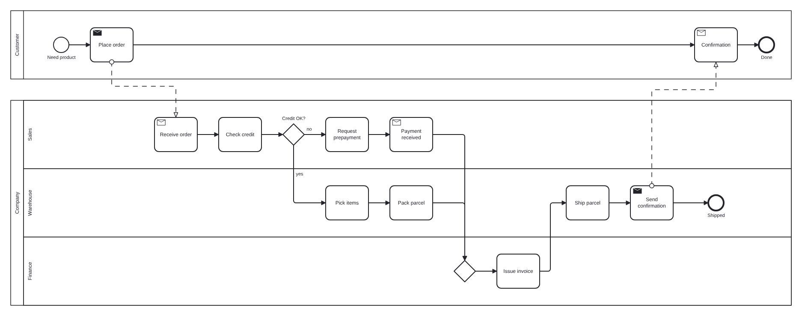

---

## 1. Design principles

1. **Story order.** Steps are written in the order they occur. Every step
   flows into the next one unless you say otherwise.
2. **Few arrows.** You only write `->` for jumps, such as loops or skipping
   ahead. Gateways split and join automatically.
3. **Names are references.** Any step can be referred to by its name, with no
   IDs needed. `@id` is available when names are ambiguous.
4. **Forgiving, precise errors.** Mistakes produce diagnostics with line and
   column numbers, an explanation and, where possible, a suggested fix.
5. **Deterministic output.** The same input always produces the same XML,
   with stable IDs, so generated `.bpmn` files diff cleanly in git.

---

## 2. Lexical structure

| Item | Rule |
|---|---|
| Encoding | UTF-8. LF and CRLF line endings are both accepted. |
| Indentation | Spaces only (a tab is an error with a quick fix). Any consistent increase opens a block, as in Python. The canonical style is 2 spaces. |
| Comments | `#` to the end of the line, when at line start or preceded by whitespace, and not inside a string, an attribute list `[...]` (so `[color: #1F4E79]` works) or `doc` text. |
| Strings | `"..."` with escapes `\"`, `\\`, `\n` (line break in a label). |
| Bare names | Unquoted text running to the end of the line or to the first *terminator* (`->`, `-(`, `~>`, `~(`, `@`, `[`, ` #`, or a trailing `:` in branch position). Leading and trailing whitespace is trimmed. |
| IDs | `@` followed by `[A-Za-z_][A-Za-z0-9_-]*`. |
| Blank lines | Ignored. They never end a block. |

**Quote a name when** it contains a terminator, ends with `:` inside a gateway,
or starts with a keyword and is used as a reference (see §6.2).

```bpmnt
task "Check stock -> reserve"     # contains "->", so it must be quoted
task Check stock                  # bare name "Check stock"
task "Line one\nLine two"         # two-line label
```

---

## 3. Document structure

```text
document   := directive* ( (pool | message-flow)+ | body )
directive  := 'title' NAME
            | 'option' KEY VALUE
pool       := 'pool' NAME attrs? NEWLINE INDENT body DEDENT
            | 'pool' NAME '[collapsed]'
body       := statement*
```

* **No `pool`:** the document is a single process. If it uses `lane`, an
  implicit pool named after the `title` (or "Process") is created, because
  BPMN tools only draw lanes inside a participant.
* **One or more pools:** the document is a *collaboration*. Each expanded pool
  has its own process. Pools are drawn top to bottom in document order.
* **Collapsed pool (black box):** `pool Bank [collapsed]` has no body. It can
  only be the source or target of message flows.

### Directives

| Directive | Meaning |
|---|---|
| `title "Name"` | Name of the collaboration/process and the default output filename. |
| `option xor-join gateway` | Default. Open XOR branches merge through an inserted XOR gateway. |
| `option xor-join direct` | Open XOR branches connect straight to the next step (implicit merge). |

---

## 4. Elements

Every element statement has the same shape:

```text
<keyword> [<name>] [@id] [[attributes]] [<flow tail>]
```

### 4.1 Events

| Notation | BPMN element |
|---|---|
| `start [name]` | None start event |
| `start message\|timer\|signal\|conditional [name]` | Typed start event |
| `end [name]` | None end event |
| `end message\|signal\|error\|escalation\|compensation\|terminate [name]` | Typed end event |
| `catch message\|timer\|signal\|conditional\|link [name]` | Intermediate catch event |
| `throw message\|signal\|escalation\|compensation\|link [name]` | Intermediate throw event |
| `wait <name>` | Shorthand for `catch timer <name>`, e.g. `wait 3 days` |

### 4.2 Activities

| Notation | BPMN element |
|---|---|
| `task <name>` | Task (abstract) |
| `user <name>` | User task |
| `service <name>` | Service task |
| `script <name>` | Script task |
| `send <name>` | Send task |
| `receive <name>` | Receive task |
| `manual <name>` | Manual task |
| `rule <name>` | Business rule task |
| `call <name>` | Call activity |
| `sub <name>` + block | Embedded subprocess (§8) |

Activity markers are given as attributes:

| Attribute | Marker |
|---|---|
| `[loop]` | Standard loop |
| `[parallel]` | Parallel multi-instance |
| `[sequential]` | Sequential multi-instance |

### 4.3 Gateways

| Notation | BPMN element |
|---|---|
| `xor [name]` | Exclusive gateway |
| `and [name]` | Parallel gateway |
| `or [name]` | Inclusive gateway |
| `event [name]` | Event-based gateway |

Gateways are always followed by a block of branches (§7).

`fork` takes the same branch block but draws **no** gateway (§7.4).

### 4.4 Data and annotations

| Notation | BPMN element |
|---|---|
| `data <name> [collection]?` | Data object reference (optional; data objects are also created automatically on first use) |
| `store <name>` | Data store reference |
| `note <text>` | Text annotation, associated with the **preceding** element |
| `[reads: A, B]` on an activity | Data input associations from A, B |
| `[writes: C]` on an activity | Data output association to C |

<!-- screenshot: notation-data -->

```bpmnt
store Inventory
task Check stock [reads: Inventory, writes: Stock report]
note Uses the nightly snapshot, not live stock
```

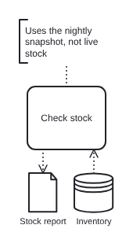

### 4.5 Attributes

Attributes are written in square brackets after the name, separated by commas.
Flags have no value. Key/value pairs use `:`. A key can take several values
separated by commas. An item of the form `key:`, or one of the flags below,
ends that list and starts the next attribute, so `[reads: A, B, loop, writes:
C]` reads A and B, sets `loop` and writes C. Quote a value that is spelt like
a flag.

```bpmnt
user Approve order @approve [parallel, reads: Order]
```

| Attribute | Applies to | Meaning |
|---|---|---|
| `id: x` | any element | Same as `@x` |
| `loop`, `parallel`, `sequential` | activities | Markers |
| `reads: …`, `writes: …` | activities, events | Data associations |
| `collapsed` | `sub`, `pool` | Collapsed subprocess / black-box pool |
| `non-interrupting` | `on` (boundary) | Dashed boundary event |
| `collection` | `data` | Collection data object |
| `lane: X` | flow nodes in a pool with lanes | Place this element in lane X without switching (§9) |
| `doc: "…"` | any element, pool, lane, group | Documentation (§4.6) |
| `color: c` | any element, pool, lane, group | Fill colour (§4.7) |
| `stroke: c` | any element, pool, lane, group | Border/line colour (§4.7) |

Unknown attributes produce a warning, not an error.

### 4.6 Documentation

`doc` attaches text to the **preceding** element as `bpmn:documentation`.
BPMN tools show it in their properties panel, and it stays in the `.bpmn`
file.

```bpmnt
service Validate order
doc Checks every order line against the product catalogue and rejects unknown items.
```

* **Raw text.** In `doc <text>`, everything after `doc ` to the end of the
  line is raw text. `#`, `->` and quotes have no special meaning there.
* **Several `doc` lines** in a row are joined with line breaks.
* **Block form:** `doc` with nothing after it, followed by an indented block.
  The block is raw text: nothing in it is parsed, and blank lines become
  paragraph breaks.

  ```bpmnt
  service Reserve stock
  doc
    Reserves the ordered quantities in every warehouse that holds
    the items, preferring the warehouse closest to the customer.

    Exception: if no stock is available -> the order is back-ordered.
  ```

* **Placement.** A `doc` before the first element of a pool, group or `sub`
  body documents that container. A `doc` before the first element of the
  file documents the process or collaboration.
* `[doc: "…"]` is the one-line attribute equivalent.
* Like notes, `doc` lines do not interrupt implicit flow.

### 4.7 Colours

`[color: …]` sets the fill and `[stroke: …]` sets the border and text
colour. They can be used on elements, pools, lanes and groups.

<!-- screenshot: notation-colours -->

```bpmnt
lanes Sales [color: #1F4E79], Warehouse [color: green]
lane Sales
task Escalate [color: #FFE0E0, stroke: red]
```

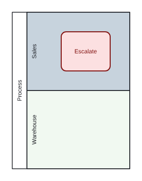

* **Values:** `#RRGGBB`, `#RGB`, or a named colour from the bpmn-js palette
  (`blue`, `orange`, `green`, `red`, `purple`) or CSS names. An invalid value
  is error **BT104**.
* **Output:** both the OMG *BPMN in Color* attributes
  (`color:background-color` / `color:border-color`) and the bpmn-js `bioc:`
  attributes, so the colours survive in Camunda Modeler, bpmn.io and other
  tools.
* **Lane colour** fills the whole lane band. BPMN DI has no way to colour
  only the lane header.
* **Lane attributes** may be given wherever the lane is named (`lanes`,
  `lane`). Conflicting values are warning **BT251**, and the last one wins.

### 4.8 Collapsed subprocess placeholders

`sub <name> [collapsed]` **without a body** is allowed. It draws a collapsed
subprocess whose detail is documented elsewhere, for example *"Credit
check"*. Use `call` instead if it refers to a reusable process.

---

## 5. Sequence: implicit flow

Within a block (a pool body, a branch or a subprocess body), **each flow node
is connected to the next flow node in the same block**.

<!-- screenshot: notation-implicit-flow -->

```bpmnt
start Order received
task Check order          # Order received -> Check order
task Ship                 # Check order -> Ship
end Done                  # Ship -> Done
```

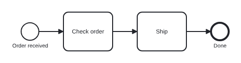

Implicit flow **does not** leave:

* an **end event**;
* a line whose last element is a **reference** (a jump, §6.2);
* a **gateway**, whose outgoing flows are its branches (§7).

Lane switches (§9), notes, `doc` lines, data and store declarations, group
blocks (§9.1) and message flows do **not** interrupt implicit flow.

**Start events.** Implicit flow **never enters a start event**. A `start` in
the middle of a block begins a new, independent chain. If the element before
it is still open (not an end event, jump or gateway), that element gets
warning **BT302 dead end**. Close it with an `end` or a jump.

<!-- screenshot: notation-start-chains -->

```bpmnt
pool Company
  lane Sales
  start timer Monthly planning
  user Create order
  end message Order issued        # closes the first chain
  lane Field service
  start timer Visit day           # new chain; nothing flows into it
  user Install equipment
```

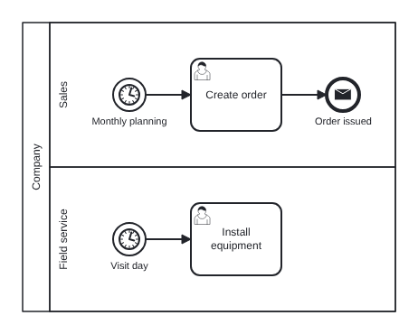

**End of a block.** Open ends left at the end of a pool or `sub` body are
dead ends (BT302). Open ends at the end of a branch are open branches (§7.1).

---

## 6. Explicit flows

### 6.1 Chains

An arrow after an element declares a flow to the element on its right. If the
right-hand side starts with an element keyword, it **declares a new element
inline**:

```bpmnt
task Pick items -> task Pack parcel -> end Packed
```

The last element of a chain continues implicitly to the next line, unless it
is an end event or a reference.

### 6.2 References (jumps)

If the right-hand side does **not** start with a keyword, it is a **reference**
to an existing element, which may be declared before or after:

<!-- screenshot: notation-jump -->

```bpmnt
task Check order
task Fix order
-> Check order            # loop back; nothing flows implicitly to the next line
```

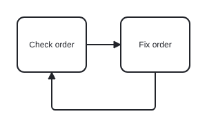

A line made of only `-> Target` creates a flow from the previous element to
`Target`.

**Several targets.** A jump can name several targets separated by commas.
Each one gets its own flow from the same source, with **no gateway**:

<!-- fragment -->

```bpmnt
service Publish order -> Update billing, Update CRM
-> Retry, Notify operator          # standalone form, from the previous element
```

Several flows into one element (an uncontrolled merge) need no special
syntax. Just jump to it from each source. For splits that *continue in story
order*, use `fork` (§7.4).

**Name resolution**

1. `@id` matches an element ID exactly.
2. Otherwise the name is matched against element names, ignoring case and
   collapsing repeated whitespace.
3. If more than one element matches, the result is error **BT201 Ambiguous
   reference**, listing the candidates with their line numbers. Fix it with
   `@id`.
4. A reference whose first word is a keyword must be quoted:
   `-> "end of month run"`.
5. Sequence flows cannot cross pools (error **BT210**). Use a message flow.

### 6.3 Flow labels

```bpmnt
task A -(after review)-> task B
```

Inside gateways, branch labels (§7) are the normal way to label flows.

### 6.4 Message flows

`~>` declares a message flow. It never affects sequence flow.

<!-- fragment -->

```bpmnt
send Place order ~> Receive order            # to an element in another pool
send Request payment ~(invoice)~> Bank       # to a (collapsed) pool, with a label
Bank ~> Payment received                     # standalone statement: pool → element
```

* Source and target must be in **different pools** (error **BT211**).
* Either end may be a pool name: the flow attaches to the pool border.
* Standalone `A ~> B` statements may appear anywhere in a pool body or at the
  top level.

---

## 7. Gateways and branches

A gateway is followed by an indented block of **branches**:

| Branch form | Meaning |
|---|---|
| `label:` | Labelled branch (condition name on the flow) |
| `"label with: colon":` | Labelled branch, quoted |
| `-` | Unlabelled branch (typical for `and`) |
| `else:` | Default flow (XOR / OR only) |

A branch is either **inline**, with a chain on the same line, or a **block**
on the following lines. It can also be both:

<!-- screenshot: notation-branches -->

```bpmnt
xor Approved?
  yes: task Ship -> end Shipped          # inline
  no:                                    # block
    task Notify customer
    end Rejected
```

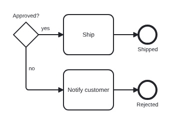

### 7.1 Automatic joins

A branch is **open** if its last element would continue implicitly, meaning it
is not an end event and not a jump. An **empty** branch (`no:` with nothing
after it) is also open and connects the split directly to the join.

When the gateway block ends, the open branches are merged into **the next
statement after the block**:

| Split | Open branches | Result |
|---|---|---|
| any | 0 | Nothing joins. The next statement needs another incoming flow (or BT301 unreachable warning). |
| any | 1 | A direct flow, with no join gateway. |
| `and` | ≥2 | An inserted **parallel** join gateway. |
| `or` | ≥2 | An inserted **inclusive** join gateway. |
| `xor`, `event` | ≥2 | An inserted **exclusive** join gateway (or direct flows with `option xor-join direct`). |

The inserted join is placed in the lane of the next statement.

<!-- screenshot: notation-and-join -->

```bpmnt
and
  - task Pick items
  - task Print invoice
task Ship                    # AND-join inserted before "Ship"
```

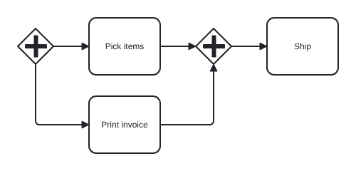

### 7.2 Event-based gateways

Every branch of `event` must start with a catch event or a receive task
(error **BT220** otherwise):

<!-- screenshot: notation-event-gateway -->

```bpmnt
event Wait for reply
  - catch message Payment received -> task Ship
  - wait 14 days -> end Cancelled
```

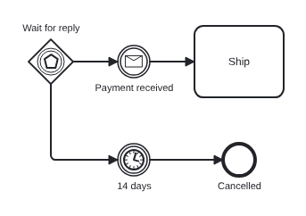

### 7.3 Explicit gateways

For merges that are not well structured, declare a gateway with an ID and
jump to it:

```bpmnt
xor Merge @m
```

A gateway with no branch block is a plain node. Jumps (`-> @m`) can target it,
and implicit flow continues out of it.

### 7.4 Fan-out without a gateway: `fork`

`fork` uses the same branch syntax as `and`, but **no gateway is drawn**.
Each branch starts with a flow straight from the preceding element. This is
an *uncontrolled split*: all branches run in parallel.

<!-- screenshot: notation-fork -->

```bpmnt
lane Orders
service Publish order
fork
  -
    lane Billing
    service Update billing
    -> Sync done
  -
    lane CRM
    service Update CRM
    -> Sync done
xor Sync done
```

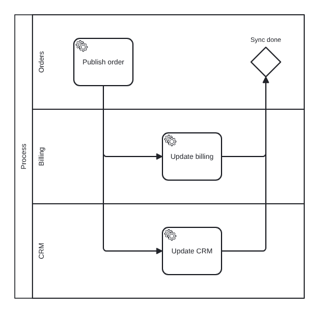

* Branches may be unlabelled (`-`) or labelled. A label goes on the flow,
  but there are no conditions and no `else:` (BT221).
* **Joins.** Open `fork` branches join like `and` branches (§7.1), with an
  inserted **parallel** join when there are two or more. This keeps the
  model semantically correct. To avoid the inserted join, end each branch
  with a jump to an element of your choice, as above.
* A `fork` must follow an element that implicit flow leaves. A `fork` right
  after an end event, a jump, or a gateway block with no open branches is
  error **BT224**.

---

## 8. Subprocesses

<!-- screenshot: notation-subprocess -->

```bpmnt
sub Handle payment
  start
  service Charge card
  xor Charged?
    yes: end Paid
    no:  end error Payment failed
```

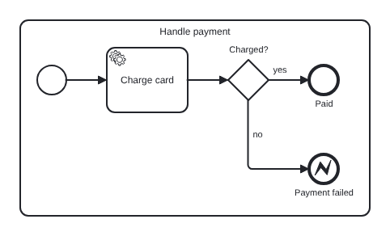

* The block is the subprocess body, with its own implicit flow scope.
* `sub Handle payment [collapsed]` draws a collapsed subprocess. The body is
  still modelled and is shown on a separate diagram plane (drill-down in
  bpmn-js).
* Jumps cannot cross a subprocess boundary (error **BT212**).
* Lanes do not apply inside a subprocess. The whole subprocess sits in its
  parent's lane.

---

## 9. Pools and lanes (lane switches)

Inside a pool, `lane <name>` **switches the current lane**. Every following
element is placed in that lane until the next switch. Implicit flow continues
across lane switches, so a process reads as one story.

<!-- screenshot: notation-lanes -->

```bpmnt
pool Company
  lane Sales
  receive Order received
  task Check credit           # Sales
  lane Warehouse
  task Pick items             # Warehouse; Check credit -> Pick items
```

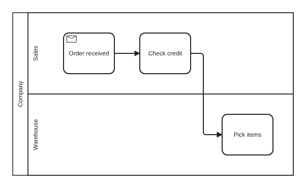

**Rules**

1. **Scoping.** A lane switch inside a gateway branch or boundary chain lasts
   until the end of that branch. After the block, the lane in effect *before
   the gateway* is restored.
2. **First lane.** In a pool that uses lanes, an element before the first
   `lane` line is error **BT230**, with the quick fix "insert `lane …` above".
3. **Lane order.** Lanes are drawn top to bottom in order of first
   appearance. You can override this with `lanes Sales, Warehouse, Finance` at
   the top of the pool body.
4. **Inline override.** `task Audit [lane: Finance]` places one element in
   another lane without switching.
5. **Nested lanes** (child lane sets) are not supported in v1.
6. **Repeated `lanes`.** `lanes` may appear several times. Each one appends
   lanes in order, which keeps long lane lists readable. Items may carry
   attributes: `lanes Billing [color: green], CRM [color: green]`.

### 9.1 Groups

A group is a dashed box around related elements, typically a **phase** of
the process. It is written as a block:

<!-- fragment -->

```bpmnt
pool Company
  group Fulfilment
    lane Sales
    start
    user Create order
    # …
  group After-sales [color: #FFF5F5]
    lane Sales
    start
    user Send satisfaction survey
    # …
```

* **Transparency.** A group block does not create a flow scope or a lane
  scope. Implicit flow and lane switches continue into, through and out of
  the group exactly as if the `group` line were not there. It only marks
  which elements belong to the group.
* **Layout.** Groups are laid out as **consecutive columns**. All elements
  of one group are placed in columns before the elements of the next group
  in document order, and no element outside a group shares its columns. By
  default the box spans the **full height of the pool** (all lanes), as for
  a phase. `[fit]` shrinks the box to the bounding box of its members
  instead.
* **Across pools.** Using the same group name in several pools gives *one*
  group whose box covers its members in all of those pools.
* **Restrictions (v1).** Groups cannot be nested, and an element can belong
  to only one group (BT250). Groups cannot be used inside a `sub`.
* **BPMN output:** a `bpmn:group` with a `categoryValue` (the label), plus a
  DI shape.

---

## 10. Boundary events

Boundary events are written as `on` lines in an **indented block under an
activity**:

<!-- fragment -->

```bpmnt
user Approve request
  on timer 48 hours -> task Escalate -> end Escalated
  on message Cancelled [non-interrupting]
    task Log cancellation
    -> Archive
```

```text
on <event-type> [name] [@id] [[attributes]] [flow tail]
```

* Event types: `message`, `timer`, `signal`, `error`, `escalation`,
  `conditional`, `compensation`.
* Interrupting by default. Add `[non-interrupting]` for a dashed event.
  Error and compensation boundaries are always interrupting (BT240 if marked
  otherwise).
* The boundary chain is a branch. If an **interrupting** boundary chain ends
  **open**, it merges into the host activity's next element through an
  automatic XOR join, as described in §7.1.
* A **non-interrupting** boundary chain must end with an end event or a jump.
  If it ends open, it gets warning **BT241** (instead of BT302) and is not
  merged, because merging it would duplicate the token on the main path.
* For a `sub` with a body, `on` lines may appear anywhere in its block. All
  other lines form the body.

---

## 11. Diagnostics

Every diagnostic has a stable code, a severity, a source range and, where
possible, a quick fix.

| Code | Severity | Meaning |
|---|---|---|
| BT001 | error | Syntax error (unexpected token / malformed statement) |
| BT002 | error | Tab used for indentation |
| BT003 | error | Inconsistent dedent (does not match any open block) |
| BT004 | error | Unterminated string |
| BT101 | error | Unknown keyword (with "did you mean …?") |
| BT102 | error | Event type not allowed here (e.g. `start terminate`) |
| BT103 | warning | Unknown attribute |
| BT104 | error | Invalid colour value |
| BT201 | error | Ambiguous reference |
| BT202 | error | Unknown reference (with closest-name suggestion) |
| BT203 | error | Duplicate `@id` |
| BT210 | error | Sequence flow crosses pools |
| BT211 | error | Message flow within one pool |
| BT212 | error | Flow crosses subprocess boundary |
| BT220 | error | Invalid branch start for event-based gateway |
| BT221 | error | `else:` on a parallel or event-based gateway |
| BT222 | warning | Gateway with a single branch |
| BT224 | error | `fork` without an open preceding element |
| BT230 | error | Element before first lane in a pool with lanes |
| BT240 | error | Invalid boundary event configuration |
| BT241 | warning | Non-interrupting boundary chain ends open |
| BT250 | error | Nested group, element in two groups, or group inside a `sub` |
| BT251 | warning | Conflicting lane attributes |
| BT301 | warning | Unreachable element (no incoming sequence or message flow, not a start event) |
| BT302 | warning | Dead end (non-end element with no outgoing flow) |
| BT303 | info | Process has no start or no end event |
| BT304 | info | Send/receive element without a message flow |

---

## 12. Grammar (EBNF summary)

```ebnf
document     = { directive } , ( { pool | msg_stmt } | body ) ;
directive    = "title" , name , NL
             | "option" , WORD , WORD , NL ;
pool         = "pool" , name , [ attrs ] , NL , [ INDENT , body , DEDENT ] ;
body         = { statement } ;
statement    = element_stmt | gateway_stmt | fork_stmt | sub_stmt
             | group_stmt | lane_stmt | lanes_stmt | goto_stmt | msg_stmt
             | note_stmt | doc_stmt | data_stmt ;

element_stmt = element , [ tail ] , NL , [ INDENT , { boundary } , DEDENT ] ;
element      = keyword , [ type ] , [ name ] , [ id ] , [ attrs ] ;
tail         = { flow_op , target } , [ "," , reference , { "," , reference } ] ;
flow_op      = "->" | "-(" , label , ")->" | "~>" | "~(" , label , ")~>" ;
target       = element | reference ;
reference    = id | name ;

gateway_stmt = gw_kw , [ name ] , [ id ] , [ attrs ] , NL ,
               [ INDENT , branch , { branch } , DEDENT ] ;
branch       = ( label , ":" | "-" | "else" , ":" ) , [ chain ] , NL ,
               [ INDENT , body , DEDENT ] ;
chain        = target , tail ;

fork_stmt    = "fork" , NL , INDENT , branch , { branch } , DEDENT ;

sub_stmt     = "sub" , name , [ id ] , [ attrs ] , NL ,
               [ INDENT , { statement | boundary } , DEDENT ] ;   (* body optional only when collapsed *)
group_stmt   = "group" , name , [ attrs ] , NL , INDENT , body , DEDENT ;
doc_stmt     = "doc" , ( TEXT , NL | NL , INDENT , RAW_TEXT_LINES , DEDENT ) ;
boundary     = "on" , ev_type , [ name ] , [ id ] , [ attrs ] , [ tail ] , NL ,
               [ INDENT , body , DEDENT ] ;

lane_stmt    = "lane" , name , [ attrs ] , NL ;
lanes_stmt   = "lanes" , name , [ attrs ] , { "," , name , [ attrs ] } , NL ;
goto_stmt    = flow_op , target , { "," , reference } , NL ;
msg_stmt     = reference , ( "~>" | "~(" , label , ")~>" ) , reference , NL ;
note_stmt    = "note" , name , NL ;
data_stmt    = ( "data" | "store" ) , name , [ attrs ] , NL ;
attrs        = "[" , attr , { "," , attr } , "]" ;
attr         = WORD , [ ":" , value , { "," , value } ] ;
```

The grammar is informal. The parser is hand-written with error recovery (see
[architecture.md](architecture.md)).

---

## 13. Worked examples

See [`examples/`](../examples) for complete files covering every feature:

| File | Shows |
|---|---|
| `01-simple.bpmnt` | Single process, implicit flow |
| `02-gateways.bpmnt` | XOR/AND/OR, labels, automatic joins, loops |
| `03-lanes.bpmnt` | One pool, lane switches, lane scoping in branches |
| `04-collaboration.bpmnt` | Two pools, message flows, a collapsed pool |
| `05-events.bpmnt` | Timers, boundary events, event-based gateway |
| `06-subprocess-data.bpmnt` | Subprocesses, data objects/stores, notes, markers |
| `07-multi-phase.bpmnt` | Eight lanes, phase groups, several start chains, `fork`, placeholders, colours, `doc` |
| `08-broadband-provisioning.bpmnt` | Seven pools (four expanded), two wholesale networks, new lines and transfers, nested event gateways, a fork with a nested optional branch |
