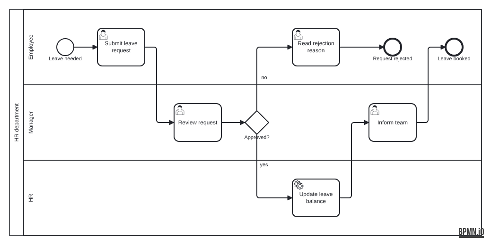
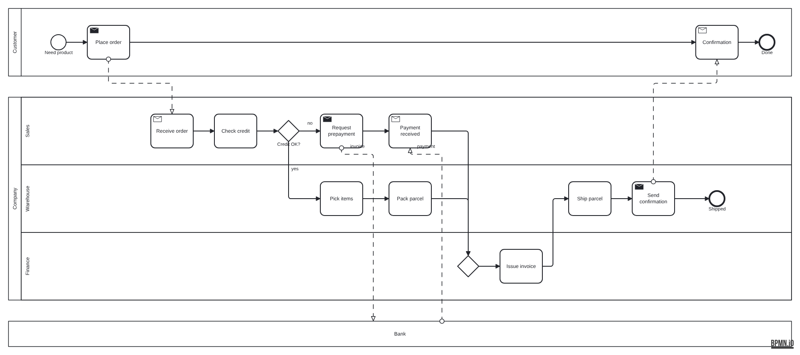
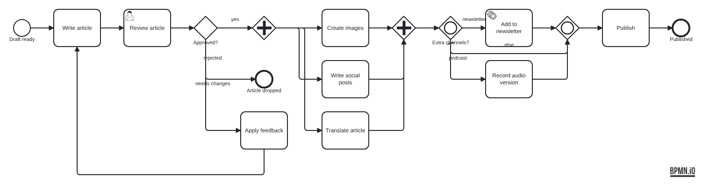

# Spike: lane-aware layout (#3)

Outcome: **option A of ADR-004 works** (ELK for global layering and ordering,
custom code for lane banding and orthogonal routing), with three amendments
to the phases in architecture §6. ADR-004 is now *Accepted*.

## What was built

The prototype is in [`packages/layout/spike/`](../../../packages/layout/spike).
It is not exported and will be replaced by the real engine (#18 to #22).

| File | Contents |
|---|---|
| `ir.ts` | A minimal IR and hand-built models of examples 02, 03 and 04 |
| `layout.ts` | Phases 2 to 6: ELK layering, rows, coordinates, sequence-flow and message-flow routing |
| `metrics.ts` | The spike's questions as numbers; a first cut of `checkLayout` (#23) |
| `bpmn.ts` | BPMN XML with DI, from string templates |
| `render.ts` | Writes the `.bpmn` files and PNGs in this directory (`node packages/layout/spike/render.ts`, Node 22.18+) |

`packages/layout/test/spike.test.ts` checks the invariants below on every
run, and validates the output with the #4 helpers (XSD, bpmn-moddle and
bpmn-js import).

Example 02 was added to the two the issue names because it is the only one
with a loop, and 03 and 04 could not answer the back-edge question.

## Results

| Example | Overlaps | Outside lane | Story inversions | Loops drawn back | Message inversions | Edges through shapes | Crossings | Bends |
|---|---|---|---|---|---|---|---|---|
| 02-gateways | 0 | 0 | 0 | 1 of 1 | 0 | 0 | 1 | 14 |
| 03-lanes | 0 | 0 | 0 | none | 0 | 0 | 0 | 8 |
| 04-collaboration | 0 | 0 | 0 | none | 0 | 0 | 2 | 13 |

Layout takes 13 to 24 ms per example (Node 22, including ELK) and is
deterministic: ten runs give identical output.

### 03: one pool, three lanes

### 04: two pools, a collapsed pool and message flows

### 02: gateways, automatic joins and a loop

## Answers

- **Is story order preserved?** Yes. With `considerModelOrder` set to
  `NODES_AND_EDGES`, no forward flow is drawn right to left in any example,
  and a split's first branch stays on the split's row when it stays in the
  same lane.
- **Are loops drawn as back edges?** Yes. `cycleBreaking: MODEL_ORDER`
  reverses exactly the flow that jumps back in the story (02, *Apply
  feedback* to *Write article*), which then runs along the lane gutter.
- **Are columns aligned across pools?** Yes, once the model order is fixed
  (amendment 1). Message flows go left to right or straight down, and a
  pool waits for the message it receives: in 04, *Confirmation* sits after
  *Send confirmation*.
- **How many crossings?** One in 02 and two in 04. In 04, the two message
  flows to and from the collapsed *Bank* pool cross sequence flows in the
  *Warehouse* lane, which cannot be avoided without moving shapes. In 02,
  two branches of the AND split cross each other in a channel because
  tracks are handed out in flow order; giving the branch that goes furthest
  the track nearest its source removes it.
- **Is option C needed?** No. ELK's model-order behaviour was reliable
  and deterministic once it was given a consistent order. The only problem
  found (amendment 1) was in the input order, not in ELK.

## Amendments to architecture §6

1. **Phase 2 needs a cross-pool story order.** ELK's model order is a single
   sequence over all nodes. Listing pools one after another makes every
   message flow from a later pool to an earlier one look like a back edge,
   and model-order cycle breaking then reverses it. With plain document
   order, 04 drew *Send confirmation* to *Confirmation* right to left. The
   fix: merge the pools' document orders so that a message flow's target
   comes after its source (a topological merge with document order as the
   tie-breaker, falling back to document order on cycles).
2. **Phase 5 chooses each route by checking for obstacles.** Gateway
   corner exits and join entries are only used when the vertical leg is
   clear. Otherwise, and for long same-row edges with shapes in between,
   the edge turns in a column channel or detours through the gap between
   rows. Channel widths come from a first routing pass that only counts
   tracks; the second pass routes on the widened geometry. This works
   because the choice of channel depends only on columns and rows.
3. **Phase 6 steps message flows aside.** A message flow whose straight
   vertical would cut through shapes in other lanes leaves the shape with a
   short stub and turns into the column channel first.

ELK reports coordinates, not layer indices. The spike recovers columns by
grouping nodes whose x ranges overlap, which is reliable because ELK
separates layers.

## Left for the real engine

These did not block the decision and belong to the layout issues:

- **Track order (#21):** order the tracks in a channel by how far each
  edge travels, so that edges leaving the same source do not cross.
- **Shared entry points (#21):** several edges entering a join from the
  same side share their last segment. Distinct ports or a small offset
  would separate them.
- **Long edges (#21):** the row-gap detour handles one long edge per row.
  Several would overlap; ELK's long-edge dummy nodes could reserve a row
  slot in each column they pass instead.
- **Back edges (#21):** a back edge's vertical leg is not yet checked for
  shapes below its source.
- **Non-adjacent pools (#22):** a message flow between pools that are not
  next to each other passes through the pool in between. Not in the corpus.
- **Labels (#18, phase 8):** the spike writes no label bounds. bpmn-js's
  defaults overlap gateway trunks in 02.
- **Rows (#20):** rows follow ELK's in-layer order with no barycentre
  pass. This was enough for the corpus; denser diagrams may need it.
