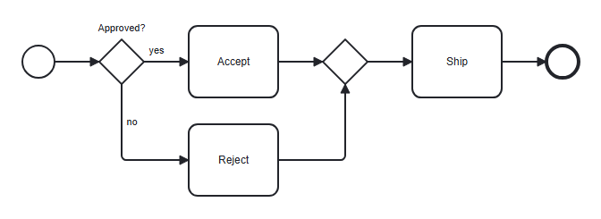
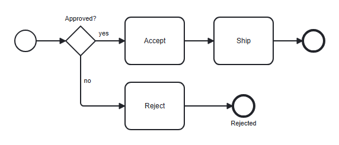
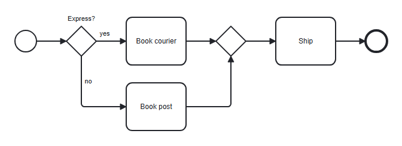

# Troubleshooting

When a diagram does not look the way you expected, start with `bpmn-text check`, or
the underlines in the editor: most surprises have a warning with a code. The
[notation reference §11.1](notation.md#111-each-code-with-an-example-and-a-fix) has an
example and a fix for every code.

```bash
bpmn-text check order.bpmnt
```

## My flow goes somewhere unexpected

Implicit flow always runs from one step to the next one you wrote. The usual
surprises come from what counts as "next".

**A branch flows on past the gateway.** An open branch merges into the statement
after the block, even if you meant it to stop. Here `Reject` also leads to `Ship`:

<!-- screenshot: trouble-open-branch -->

```bpmnt
start
xor Approved?
  yes: task Accept
  no: task Reject
task Ship
end
```



End the branch where it should stop:

<!-- screenshot: trouble-closed-branch -->

```bpmnt
start
xor Approved?
  yes: task Accept
  no: task Reject -> end Rejected
task Ship
end
```



**A jump does not come back.** A line ending in a reference stops implicit flow, so
the next line needs another way in:

```bpmnt
start
task Check order -> Ship
task Print label
task Ship
end
```

Here `Print label` is unreachable (BT301), because `Check order` jumped past it. Use
a gateway if both should be possible.

**A lane switch seems to be lost.** A `lane` inside a branch ends with that branch
([notation §9](notation.md)), so the step after the block is back in the lane from
before the gateway. Write `lane` again after the block.

**Two steps have one name.** A reference to that name is an error (BT201), but a chain
written by mistake is not: `task Check -> task Check` declares a second element. Refer
to an existing one without the keyword: `task Fix -> Check`.

**An event subprocess seems to be skipped.** That is right: flow passes `sub X [event]`
by, whatever comes before and after it. Only its start event starts it.

## An extra gateway appeared

The compiler inserts a join when two or more branches of a split are open at the end of
the block, so every path merges correctly. The join has the same kind as the split,
except that `event` splits get an exclusive one.

<!-- screenshot: trouble-join -->

```bpmnt
start
xor Express?
  yes: task Book courier
  no: task Book post
task Ship
end
```



To change that:

| You want | Write |
|---|---|
| XOR branches to flow straight into the next step | `option xor-join direct` at the top of the file |
| No join for `and` or `fork` branches | End each branch with a jump to the step of your choice |
| A join somewhere else | Declare it, as `xor Merge @m`, and jump to `@m` |
| No join because the branch ended | End the branch with `end` or a jump |

**A join with no split near it.** An interrupting boundary chain that ends open merges
with the main path after its activity, through an inserted exclusive join
([notation §10](notation.md)). End the chain to remove it.

**Two joins in a row.** A nested split gets its own join first, and then is one open end
of the outer split ([notation §7.1](notation.md)).

**IDs change.** A join is named after what it leads into, as
`Gateway_join_after_ship`, so renaming that step changes the join's ID
([notation §6.5](notation.md)).

## Why is this element unreachable?

BT301 means nothing flows into the element. Look at the line above it:

| The line above is | Why | Fix |
|---|---|---|
| `end …` | Flow stops at an end event | Move the `end` down, or jump to this element |
| A jump (`-> Name`) | A reference ends implicit flow | Jump to this element from somewhere, or remove the jump |
| A gateway block where every branch ended | No open branch merges into it | Leave a branch open, or jump here |
| `throw link …` | Flow continues at the catch event | Start a new chain with `catch link …`, or remove the throw |
| A declared `xor Name @m` with no jumps to it | It takes flow only from jumps | Add `-> @m`, or remove the gateway |

For example, every branch of this gateway ends, so nothing reaches `Archive`:

<!-- expect-error BT301 -->

```bpmnt
start
xor Approved?
  yes: end Shipped
  no: end Rejected
task Archive
end
```

**The first step of a branch is unreachable.** After a `fork` with nothing to fan out
from (BT224), its branches have no incoming flow.

**A step after a `start` has a dead end before it.** The two go together: `start` begins
a new chain, so the step above it has no way out (BT302).

**A subprocess step.** Each `sub` body has its own flow, so its first step needs a
`start` or a chain of its own. A jump cannot enter from outside (BT212). An ad-hoc
subprocess is the exception, as its activities need no flow.

## Why is nothing drawn?

The file has errors and the output shows what could be built, or the shape has no body:
a `sub` without a block must be `[collapsed]`. A `data Invoice` line draws no shape of its
own once `Invoice` is used in some state ([notation §4.4](notation.md)). `doc` lines draw
nothing at all: they go in the file as documentation.
