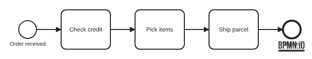
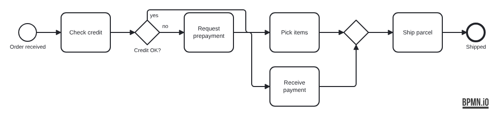
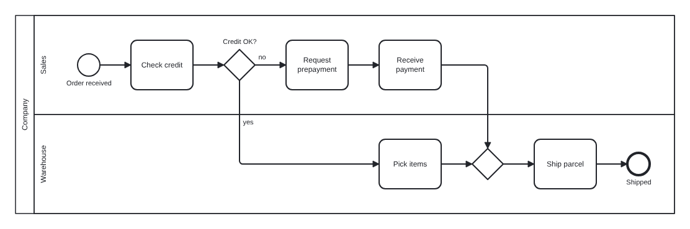
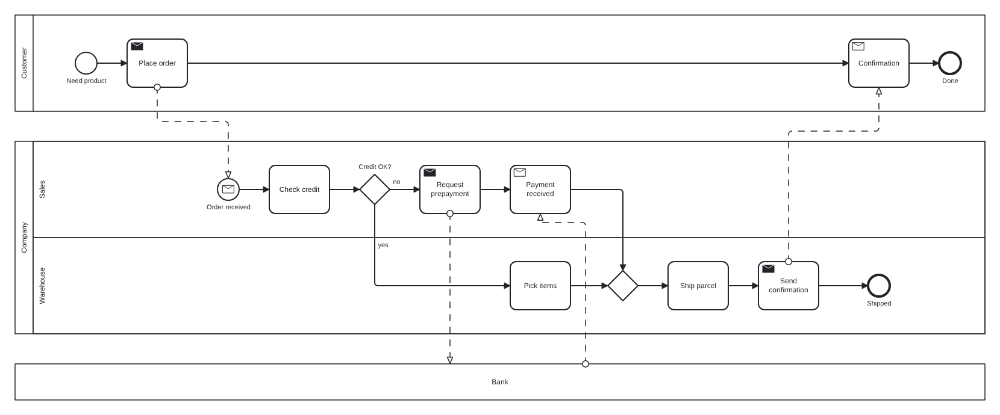
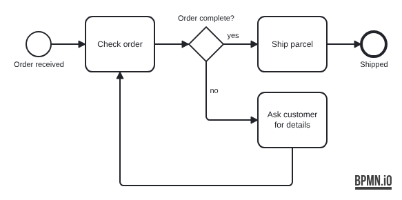
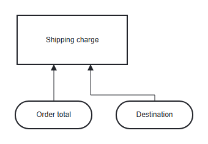

# Tutorial: your first diagram in 15 minutes

In this tutorial you build an order-fulfilment process step by step: a
customer orders, the company checks credit, picks and ships the goods, and
a bank takes part in payment. Each step adds one idea and shows the diagram
it produces. The last step writes the rules behind a decision as a DMN
decision table.

You need either the [web editor](../apps/editor/README.md) or the command
line. The [Quick start](../README.md#quick-start) command installs both, and
starts the editor with `--serve`.

With the command line, save each step as `order.bpmnt` and run:

```bash
bpmn-text build order.bpmnt -o order.bpmn          # open in Camunda Modeler or bpmn.io
bpmn-text build order.bpmnt -f svg -o order.svg    # or look at a picture
```

## Step 1: steps in story order (2 minutes)

Write the steps in the order they happen, one per line. Every step flows
into the next one: you never draw an arrow for the normal sequence.

<!-- screenshot: tutorial-1 -->

```bpmnt
title "Order fulfilment"

start Order received
task Check credit
task Pick items
task Ship parcel
end Shipped
```



`start` and `end` are events, `task` is an activity. More specific kinds of
task exist, such as `user`, `service`, `send` and `receive`; they only
change the icon. Try changing `task Check credit` to `service Check
credit`.

## Step 2: a decision (3 minutes)

A gateway is followed by an indented block of branches. Each branch is
`label:` and then its steps, on the same line or indented below.

<!-- screenshot: tutorial-2 -->

```bpmnt
title "Order fulfilment"

start Order received
task Check credit
xor Credit OK?
  yes:
    task Pick items
  no:
    task Request prepayment
    task Receive payment
task Ship parcel
end Shipped
```



Both branches end open, so they **merge automatically** into the next step,
`Ship parcel`, through an inserted exclusive gateway. You did not have to
name or draw the merge.

> **Note:** a branch that ends with `end …` does not merge: it finishes the
> process there. Try changing the `no:` branch to `no: end Rejected`.

## Step 3: who does what (3 minutes)

Put the process in a pool and split it into lanes. `lane X` switches the
current lane: every following step goes into lane X until the next switch.
The flow still reads as one story across lanes.

<!-- screenshot: tutorial-3 -->

```bpmnt
title "Order fulfilment"

pool Company
  lane Sales
  start Order received
  task Check credit
  xor Credit OK?
    yes:
      lane Warehouse
      task Pick items
    no:
      task Request prepayment
      task Receive payment
  lane Warehouse
  task Ship parcel
  end Shipped
```



A lane switch inside a branch lasts only until the end of that branch, so
the `no:` branch stays in Sales. That is why `lane Warehouse` is needed
again before `Ship parcel`.

## Step 4: talking to the customer (4 minutes)

A second pool makes the diagram a collaboration. `~>` draws a message flow
between pools; it never changes the sequence flow. The target can be
declared later in the file.

<!-- screenshot: tutorial-4 -->

```bpmnt
title "Order fulfilment"

pool Customer
  start Need product
  send Place order ~> Order received
  receive Confirmation
  end Done

pool Company
  lane Sales
  start message Order received
  task Check credit
  xor Credit OK?
    yes:
      lane Warehouse
      task Pick items
    no:
      send Request prepayment ~> Bank
      receive Payment received
  lane Warehouse
  task Ship parcel
  send Send confirmation ~> Confirmation
  end Shipped

pool Bank [collapsed]
Bank ~> Payment received
```



`pool Bank [collapsed]` is a black box: a partner whose inside you do not
model. Message flows can start or end at the pool itself, as in the last
line.

## Step 5: loops and jumps (2 minutes)

To go anywhere other than the next line, write `-> Name`. Names are
references: you do not need IDs.

<!-- screenshot: tutorial-5 -->

```bpmnt
title "Order fulfilment"

start Order received
task Check order
xor Order complete?
  yes:
    task Ship parcel
  no:
    task Ask customer for details
    -> Check order
end Shipped
```



A line that ends with a jump does not continue to the next line, so the
`no:` branch is not merged into `Shipped`: it loops back instead.

## Step 6: check and tidy (1 minute)

The compiler explains mistakes with a line, a column and, where it can, a
fix. Misspell a reference, for example `-> Chek order`, and run:

```bash
bpmn-text check order.bpmnt
```

```text
error[BT202]: Nothing is called `Chek order`. Did you mean `Check order`?
 --> order.bpmnt:10:8
```

The web editor underlines the same mistake as you type and offers the fix.
When the file is right, `bpmn-text fmt order.bpmnt` rewrites it in
canonical style.

## Step 7: the rules behind a decision (5 minutes)

`Order complete?` is a question someone answers by hand. A shipping charge is
different: it follows rules, and the rules change. Write them in a `.dmnt` file
beside `order.bpmnt`, as a decision table. In the web editor, choose **DMN** in
the selector at the top left.

<!-- screenshot: tutorial-7 -->

```dmnt
title Shipping

input Order total [type: number]
input Destination [type: string, values: "home", "abroad"]

decision Shipping charge [requires: Order total, Destination]
  table [hit: unique]
    | Order total | Destination | -> Charge: number | // Why             |
    | >= 50       | "home"      | 0                 | Free over 50      |
    | < 50        | "home"      | 4.95              |                   |
    | -           | "abroad"    | 12                | One rate abroad   |
```



Each rule is one line. Columns before `->` are inputs, written as tests such
as `>= 50`, with `-` for any value; columns after it are outputs; the `//`
column is a note. `bpmn-text fmt` keeps the columns aligned.

The compiler checks the table as a whole. Change the first rule to `>= 40` and
it reports that rules 1 and 2 both match an order of 40 up to 50 at home, which
a `unique` table must not allow. Remove the last rule and it reports that no
rule matches `Destination = "abroad"`.

Then name the decision from the process, on a business rule task:

```bpmnt
start Order received
rule Work out shipping [decision: Shipping charge]
task Ship parcel
end Shipped
```

`bpmn-text check order.bpmnt` now checks that a decision called `Shipping charge`
exists in a `.dmnt` file beside it, and suggests the closest name if not.
`bpmn-text build shipping.dmnt -o shipping.dmn` writes DMN that opens in Camunda
Modeler; with `-f png`, you get the diagram and a picture of each table.

## What next

- Add `option colors all` at the top for a colourful diagram, and run
  `bpmn-text legend order.bpmnt -f png -o key.png` for a key to its symbols
  ([recipe](cookbook.md#colour-and-a-key)).
- The [cookbook](cookbook.md) has recipes for common patterns and errors.
- The [notation reference](notation.md) describes every statement, with an
  example and a fix for every diagnostic; the [DMN notation](dmn-notation.md)
  does the same for `.dmnt` files.
- [Troubleshooting](troubleshooting.md) explains unexpected flows and extra
  gateways.
- The [examples](../examples) show complete processes, from a simple one to
  a [multi-phase process with eight lanes](../examples/07-multi-phase.bpmnt).
